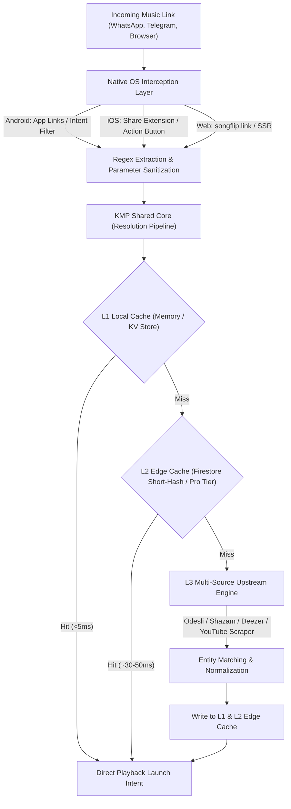
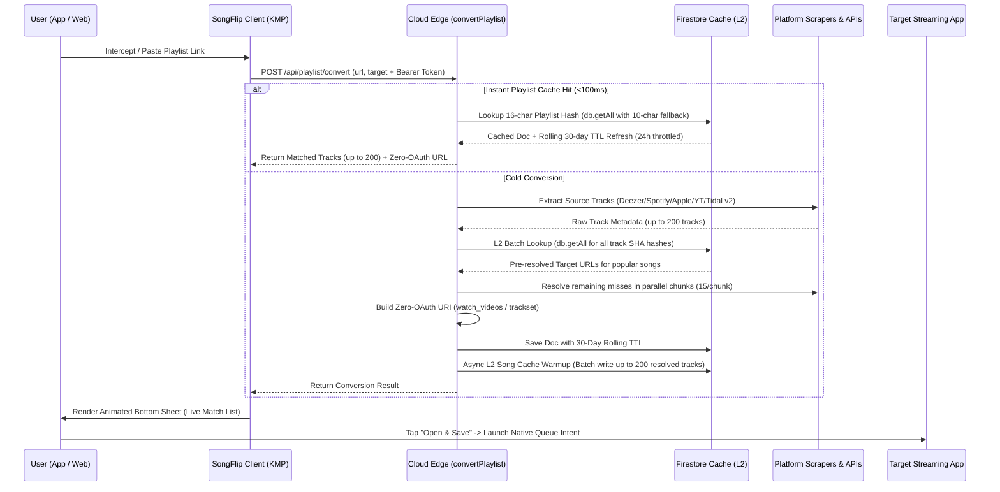

# SongFlip Architecture & Internals 🏛️

This document outlines the technical design, architectural patterns, and resolution pipeline powering **SongFlip**.

SongFlip is designed to solve a simple problem with high engineering rigor: **How to intercept, resolve, and redirect cross-platform music links with sub-50ms latency, zero intermediate UI, and zero user tracking.**

---

## 1. High-Level System Overview

SongFlip operates across four client layers (Android, iOS, Desktop Browser Extension, Web) backed by a shared Kotlin Multiplatform engine and a serverless edge cache:



---

## 2. The Resolution Pipeline (Step-by-Step)

### Step 1: Deterministic URL Sanitization & Robust Search Normalization
Music streaming services append aggressive tracking clutters to share links (e.g. `?si=...`, `?context=...`, `?utm_source=...`, `intl-*` subdomains).
Before hashing or resolving, the URL is strictly canonicalized:
- Tracking query parameters are stripped, and social redirect wrappers (`youtube.com/redirect?q=...`, `l.facebook.com/l.php`, `l.instagram.com`) are unwrapped before validation, normalization, and entity detection.
- Canonical entity types (`track`, `album`, `artist`, `playlist`, `podcast`) and platform IDs are extracted via regex guards (including Last.fm `/+noredirect/` track/album routes).
- Eliminating tracking parameters maximizes cache hit rates across different social networks.
- **Strict Host & Domain Verification (`isHostOrSubdomain`):** URL parsing validates hostnames against explicit service domains (and subdomains) instead of substring matching, preventing spoofed URLs (e.g. `evil-spotify.com`, `notspotify.com`) from triggering matching or query extraction.
- **Search Query & Symbol Sanitization (`cleanSearchQuery`):** Fallback and deep-search queries are automatically sanitized across KMP and backend pipelines—stripping noise tags (`- 2011 Remaster`, `(Radio Edit)`, `[Live]`), disruptive search-breaking symbols (`+`, `&`, `#`, `|`, `/`, `:`, quotes), variation selectors, and emojis (`🎙️`, `🔥`) into clean whitespace. This prevents index failures on strict full-text search engines (such as Pocket Casts, Apple Podcasts, Spotify search operators, Tidal, and Deezer).
- **Context-Sensitive Video Title Cleaning (`cleanVideoTitle`) & Remix Safeguards (v1.13.3 / #208):** Strips bracketed and parenthesized video clutter (`[Official Music Video]`, `(Lyrics)`, `[4K 60FPS]`, `(Visualizer)`, `(Audio)`) from YouTube oEmbed and web titles while context-sensitively preserving authentic musical attributes (`(XYZ Remix)`, `(Live at Wembley)`). In `ResolverUtils.findBestCandidate()`, candidate ranking across Apple Music, Deezer, Tidal, and Qobuz penalizes unrequested remixes (`-120`) to protect original studio tracks from remix traps, while rewarding remix candidates when explicitly requested.

### Step 2: Tiered Caching Architecture

| Tier | Technology | Latency | Scope & Invalidation |
|---|---|---|---|
| **L1 (Local)** | In-Memory + SQLDelight ACID SQLite Store (`songflip_store.db`, WAL mode) | `< 5 ms` | Device-only (shared across iOS App Group `group.de.goork.songflip` & Android). Sub-millisecond playback launch for repeated tracks with automatic legacy JSON migration. Resolver hits are fresh for 7 days; conversion history and favorites are retained indefinitely (favorites pinned: up to 10 in Free tier, unlimited in Pro). Always active on all devices. |
| **L2 (Edge Cache)** | Serverless Firestore Edge *(Pro Tier read / Crowdsourced write)* | `~30–50 ms` | Global, indexed via 12-char SHA-256 short hashes (`/resolve` & `/ingest`). Reading is reserved for SongFlip PRO & Web Converter (`songflip.link/s/...`), while background ingestion is crowdsourced across all platforms (Android, iOS, Web). |
| **L3 (Upstream)** | Multi-Provider Aggregator | `~200–500 ms` | Cold fallback only. Queries Odesli, iTunes Search API, Deezer Catalog API, Qobuz Public API, and Shazam REST directly from the client. |

> **Architectural Note on Tiering:** SongFlip's client engine is completely autonomous and operates with 100% functionality on device using L1 + L3 alone. The L2 Edge Cache is an optional, serverless performance tier that eliminates client-side network roundtrips for popular music entities.

### Step 3: Self-Healing & Edge Cases
- **Playlist Entity Interception:** While standard redirect flows focus on single tracks and albums, incoming playlist URLs (`/playlist/...`) are intercepted early and routed to the **Universal Playlist Converter (v1.4+)** bottom sheet in the native client rather than failing (tracked via `playlist_routed`).
- **Dedicated Cross-Platform Podcast Resolution (v1.6+):** Shared podcast episodes and shows (Spotify, Apple Podcasts, YouTube Music, Pocket Casts, Deezer, Amazon Music) are resolved via a dedicated pipeline (`isPodcastUrl()`) using iTunes Lookup API metadata, OpenGraph scraping, serverless L2 caching (`l2_podcast_cache`), and direct deep-search intents (`ResolutionResult.Podcast`), complete with emerald FlipPages and embedded audio playback.
- **Audiobook Interception & Notice:** Due to closed ecosystems and DRM restrictions, audiobooks (e.g. `open.spotify.com/audiobook/...`) are intercepted early (`isAudiobookUrl()`) and short-circuited with a structured explanation (`ResolutionResult.PodcastOrAudiobook`) to prevent 404s or broken redirects.
- **Social Sessions & Personal Profiles (Spotify Blend, Jam, Live, Users):** Non-music session links (such as `open.spotify.com/blend/` or `/jam/`) cannot be converted across providers. SongFlip intercepts these via `isSocialOrSessionUrl()` and seamlessly forwards them directly to the native host app (`ResolutionResult.UnsupportedEntity`), tracking `unsupported_entity_intercepted` instead of error events.
- **Fast-Fail Foreign Domain Interception (v1.9.11 / #132):** When users share social video or generic web links (e.g. `vm.tiktok.com`, `instagram.com/reel/...`, `musiccloud.io`) via the system share sheet, `SongLinkEngine` checks `UrlUtils.isSupportedMusicOrAggregatorUrl(canonicalUrl)` immediately after shortlink expansion. Unrecognized domains short-circuit with `ResolutionResult.UnsupportedEntity(entityType = "unsupported_domain")` without making an upstream API request, display a localized tip pointing to **Listen & Flip**, and forward the original URL without delay while logging `unsupported_entity_intercepted` instead of `link_flip_failed`.
- **YouTube Shorts Normalization:** Shared YouTube Shorts links (`youtube.com/shorts/{id}`) are automatically canonicalized into full video/track links (`music.youtube.com/watch?v={id}`), enabling immediate cross-platform flipping without failure.
- **Self-Titled Albums:** Search APIs frequently map an album name (matching the artist's name) to a single track video instead of the album playlist. SongFlip enforces strict entity type validation (`music.youtube.com/playlist?list=OLAK5uy_...` for albums) to prevent single-video downgrades.
- **Shazam Links:** Apple's Shazam CDN blocks standard user agents with HTTP 405. SongFlip leverages the internal discovery REST endpoint (`amp.shazam.com/discovery/v5/...`) with native headers to retrieve clean Apple Music and ISRC identifiers without auth.
- **Offline Buffering & Intermittent Network Resilience (v1.4.15+):** When a user taps a music link during low or missing connectivity (e.g. subway tunnels, elevators, dead zones), SongFlip does not crash or fail with dead-end error toasts. The native layer registers a reactive network state listener (`NetworkUtils.observeNetworkState()`). An animated bottom sheet (`OfflineWaitingBottomSheet`) holds the parsed entity intent, displays real-time connection status with auto-retry, and executes the resolution pipeline the instant `NET_CAPABILITY_INTERNET` and `NET_CAPABILITY_VALIDATED` are restored—launching target playback seamlessly.
- **Regional Domains & Morphe/ReVanced:** On Android, custom modded packages (e.g. `app.morphe.android.apps.youtube.music`, `app.revanced.android.apps.youtube.music`, `app.rvx...`) are prioritized and regional Amazon Music domains (`music.amazon.de`, `music.amazon.co.uk`) are dynamically supported.
- **Dedicated Player Isolation & Paywall-Free Web Fallback (v1.5.2):** Installed player detection strictly isolates dedicated streaming apps (e.g. YouTube Music, ViMusic, RiMusic vs. standard YouTube video players). If a target streaming app is not installed on the device, SongFlip converts the specialized web URL (e.g. `music.youtube.com/watch?v=...`) via `UrlUtils.toWebFallbackUrl()` to standard `youtube.com/watch?v=...` before browser dispatch. This completely avoids mobile landing paywalls ("Music Premium 1 month free") and ensures immediate, unrestricted playback in standard video players or mobile browsers.
- **Flicker-Free Redirect Overlay Threshold (v1.13.3 / #210):** `RedirectActivity` implements a 350ms debounced loading threshold. Instantaneous link resolutions (<350ms from memory or L2 edge cache) remain completely transparent and flicker-free, while longer network scrapes smoothly display a centered status indicator.
- **Android DomainVerification Conflict & Grabber Detection (v1.13.3 / #207):** `LinkDiagnosisManager` diagnoses all 10 streaming platforms and inspects `DomainVerificationUserState` on Android 12+. When another app captures a domain, SongFlip detects the exact grabber package name and friendly app label, offering 1-tap navigation to `Settings.ACTION_APP_OPEN_BY_DEFAULT_SETTINGS` to easily resolve link hijacking.
- **Settings Backstack Navigation & Sheet M3 Color Consistency (v1.13.3 / #205):** Integrated `BackHandler` in `SettingsBottomSheet` ensures system back gestures dismiss nested sub-sheets (Language Picker, History, Feedback) without closing settings, while explicit `containerColor = surface` and `tonalElevation = 0.dp` across all 16 ModalBottomSheets eliminate Material 3 lilac/purple tint inconsistencies.
- **Alternative & Modded Target Player Support (v1.13.4 / #204):** Deep launch routing and fallback detection across audiophile and FOSS media players: USB Audio Player PRO (UAPP, `com.extreamsd.usbaudioplayerpro`), BubbleUPnP (`com.bubblesoft.android.bubbleupnp`), Musify (`com.valentinilk.shuzik`), AntennaPod (`de.danoeh.antennapod`), Pocket Casts (`au.com.shiftyjelly.pocketcasts`), and Podcast Addict (`com.bambuna.podcastaddict`). UAPP and BubbleUPnP receive direct high-resolution web and streaming URLs, Musify receives paywall-free translated web URLs, and dedicated podcast clients receive direct package launch intents without intermediate chooser dialogues.
- **Autonomous Client-Side Emergency Scrapers (v1.13.4 / #209):** When upstream aggregator APIs or third-party catalog endpoints experience downtime, rate limiting, or regional blocks, `:shared` executes zero-auth client-side scrapers: `SpotifyResolver.extractEmbedMetadata` extracts structured metadata directly from the `open.spotify.com/embed/track/...` `__NEXT_DATA__` JSON payload (with OpenGraph tag fallback), while `YouTubeMusicResolver.extractVideoDetails` leverages the anonymous YouTube Music Innertube `WEB_REMIX` client endpoint (`music.youtube.com/youtubei/v1/player`) to retrieve canonical titles, channel names, and durations with zero API keys or user sign-in.

### Step 4: Cross-Platform Entity Mapping & Graceful Fallback Strategy

SongFlip enforces deterministic 1:1 entity mapping across streaming platforms:
- **Track $\rightarrow$ Track:** Direct playback launch (`autoplay` / native deep-link intent).
- **Album $\rightarrow$ Album:** Direct album view (playlist / collection ID).
- **Artist $\rightarrow$ Artist:** Direct artist profile page.
- **Podcast $\rightarrow$ Podcast:** Direct show/episode deep search and launch (`podcast://`, `spotify:search:`, `pocketcasts://`).
- **Playlist $\rightarrow$ Playlist:** Universal batch conversion with Zero-OAuth queue import (up to 200 tracks with multi-chunking & deduplication).

When an upstream resolver (e.g. Odesli) lacks a mapping for a target platform (frequent with regional identifiers such as Amazon Music ASINs), SongFlip applies a tiered fallback rather than failing hard:

1. **Secondary Auth-Free API Resolvers with Strict Similarity Matching (`ResolverUtils`) & Circuit Breakers:**
   - **Apple Music:** iTunes Search & Lookup API (`?i=<id>`, `/song/<id>`, `/album/<id>` with storefront country routing and HTML OpenGraph fallback) queries collection/track IDs with strict title/artist token overlap verification (rejecting false-positive compilations).
   - **Deezer:** Deezer Public Search API resolves direct album/track URLs with fuzzy name matching.
   - **Tidal:** Tidal OpenAPI v2 (`openapi.tidal.com/v2/searchResults`, `/v2/tracks/{id}`, `/v2/albums/{id}`, `/v2/playlists/{id}`) via OAuth2 Client Credentials (`auth.tidal.com/v1/oauth2/token`) with automatic `401` token refresh and `HTTP 429` retry-backoff across tracks, albums, artists, and playlists.
   - **Qobuz:** Qobuz Public Catalog API resolves direct track, album, and artist IDs with strict title/artist similarity validation. Playlist matching in Cloud Functions backend resolves tracks via public catalog search with Zero-OAuth fallback.
   - **Idagio, Anghami & SoundCloud:** Direct scrapers and oEmbed lookups protected by progressive-backoff in-memory circuit breakers (`15 min → 60 min → 6 h` on HTTP `401`/`403`/`406`/`429`/`503`), a 60-minute per-URL SoundCloud oEmbed negative cache, and deterministic URL-slug fallbacks when cloud IPs or tracks are blocked or rate-limited (mirrored in KMP `SoundCloudResolver` & `MetadataExtractor` via `PlatformCircuitBreaker`).
   - **YouTube Music:** YouTube Music scraper resolves `browse/MPREb_...` album IDs and `watch?v=...` video IDs.
   - **Token & Diacritics Normalization (v1.12.5):** `ResolverUtils.isMatch` normalizes Unicode accents, diacritics (`é -> e`, `ñ -> n`), stylized leetspeak (`p!nk -> pink`, `ke$ha -> kesha`), and enforces minimum token coverage so tracks with matching artists but different titles (e.g. Queen "Bohemian Rhapsody" vs "Radio Ga Ga") are rejected before falling back to search.
2. **Deterministic Search Fallback (Graceful Degradation):**
   Platforms without open, auth-free public search APIs (**Amazon Music**, **Spotify**, **SoundCloud**, **Bandcamp**, **Beatport**, **Pocket Casts**) or when candidate metadata diverges significantly gracefully fall back to pre-populated search deep-links (e.g. `amznmp3://music.amazon.com/search/<Artist>+<Album>`, `spotify:search:...`, `soundcloud://search?q=...`, `podcast://...`). This guarantees that the user always lands on the desired content with zero dead-ends and zero wrong-track misdirects.

| Target Platform | Track Intent | Album Intent | Artist Intent | Podcast Intent | Secondary Lookup | Miss Fallback |
| :--- | :--- | :--- | :--- | :--- | :--- | :--- |
| **YouTube Music** | `watch?v=` | `browse/MPREb_...` / `playlist?list=` | `channel/UC...` | `search?q=` | ✅ YouTube Scraper | `music.youtube.com/search?q=` |
| **Apple Music / Podcasts** | `/song/<id>` | `/album/<id>` | `/artist/<id>` | `podcast://podcasts.apple.com/search` | ✅ iTunes API | `music.apple.com/search?term=` |
| **Deezer** | `deezer://.../track/` | `deezer://.../album/` | `deezer://.../artist/` | `deezer.com/search/` | ✅ Deezer API | `deezer.com/search/` |
| **Pocket Casts** | — | — | — | `pocketcasts://search?q=` | ❌ None (Search intent) | `play.pocketcasts.com/podcasts/search?q=` |
| **Spotify** | `spotify:track:<id>` | `spotify:album:<id>` | `spotify:artist:<id>` | `spotify:search:<query>` | ✅ Backend Live Resolver (ISRC/Title) | `spotify:search:<query>` |
| **Amazon Music** | `amznmp3://... ?trackAsin=` | `amznmp3://.../albums/<ASIN>` | `amznmp3://.../artists/<ASIN>` | `music.amazon.com/search/` | ❌ None (ASIN regional) | `amznmp3://music.amazon.com/search/` |
| **Tidal** | `tidal://track/<id>` | `tidal://album/<id>` | `tidal://artist/<id>` | — | ✅ Tidal OpenAPI v2 (`openapi.tidal.com/v2`) | `listen.tidal.com/search?q=` |
| **SoundCloud** | `soundcloud://sounds:<id>` | `soundcloud://sets:<id>` | `soundcloud://users:<id>` | — | ✅ SoundCloud oEmbed / Scraper + Circuit Breaker | `soundcloud://search?q=` |
| **Bandcamp** | `bandcamp://...` | `bandcamp://...` | `bandcamp://...` | — | ❌ None (Web only) | `bandcamp.com/search?q=` |
| **Qobuz** | `qobuzapp://track/<id>` | `qobuzapp://album/<id>` | `qobuzapp://artist/<id>` | — | ✅ Qobuz Public API | `play.qobuz.com/search?q=` |
| **Beatport** | *(Source only)* | *(Source only)* | — | — | ✅ Beatport OG Scraper | `beatport.com/search?q=` |
| **Audiomack** | `audiomack://...` | `audiomack://...` | — | `audiomack.com/search?q=` | ✅ Audiomack Scraper | `audiomack.com/search?q=` |
| **Idagio** | `idagio://...` | `idagio://...` | — | `app.idagio.com/search?q=` | ✅ Idagio Scraper | `app.idagio.com/search?q=` |
| **Anghami** | `anghami://song/<id>` | `anghami://album/<id>` | `anghami://artist/<id>` | `play.anghami.com/search?query=` | ✅ Anghami Scraper & Search | `play.anghami.com/search?query=` |
| **Last.fm** | *(Source only)* | *(Source only)* | — | — | ✅ Last.fm Path + OG Fallback | *(Target-agnostic)* |

---

## 3. Universal Playlist Conversion Architecture (Zero-OAuth Pipeline)

SongFlip includes a high-performance **Universal Playlist Converter** operating without requiring user account credentials or OAuth authorizations:



### Core Playlist Pipeline Components:
1. **Extraction Scrapers & Early Track Capping:** Zero-auth extraction for Deezer API (`/playlist/{id}`), Spotify embed scraper, YouTube Music initial page data (`playlist?list=`, `watch?list=`, `/browse/VL...`), Apple Music meta tags, and Tidal OpenAPI v2 (`/v2/playlists/{id}` with cursor pagination). Both source pagination and file imports enforce the caller's active track cap (`5` for free previews, up to `200` for Pro) before full extraction while preserving `totalTrackCount` for accurate UI indicators. Reconverting existing `songflip.link/(file-import|p|playlist)/<id>` history entries resolves stored track lists directly for any new target platform without requiring the original file again.
2. **L2 Batch Cache Acceleration:** Evaluates all track URLs simultaneously via a single Firestore batch lookup (`db.getAll(...docRefs)`) to reuse previously resolved single-track mappings in `<50ms`.
3. **Parallel Chunk Matching:** Resolves remaining cache misses in concurrent chunks (15 at a time) via target search scrapers and iTunes API.
4. **Zero-OAuth Queue Generation:**
   - **YouTube Music:** Resolves `www.youtube.com/watch_videos?video_ids=...` via HTTP 303 location redirection into a direct `music.youtube.com/watch?v={id}&list=TLGG...` queue playlist, with intelligent direct-track fallback (`music.youtube.com/watch?v={firstId}`) to prevent automated bot traffic blocks.
   - **Spotify:** Generates `spotify:trackset:{Title}:{id1},{id2}...` URI schemes.
5. **Multi-Chunk Scaling (up to 200 tracks), Deduplication & File Export (v1.8.0+):** Extended beyond the 50-track limit to handle large playlists with up to 200 songs.
   - **Track Deduplication:** Case- and whitespace-insensitive deduplication removes duplicate titles before matching.
   - **Part Chunking (`PlaylistChunk`):** Automatically segments large playlists into 50-track sub-queues (`Part 1`, `Part 2`...), each playable with a single tap in YouTube Music and Spotify.
   - **Universal File Export:** Generates Extended M3U8 (`audio/x-mpegurl`) and RFC 4180 CSV files directly on-device for desktop media players and cloud libraries. M3U8 exports strip CR/LF control characters from metadata and validate `https://` target URLs (`UrlUtils.isSafeTargetUrl`) before writing track entries.
6. **SSR Web Sharing (`songflip.link/s/...` & `songflip.link/p/...`) & oEmbed 1.0 (`/api/oembed`):** Server-rendered, localized web pages with strict CSP hardening, CDN edge-cache resilient client-device prioritization (synchronous DOM reordering via `navigator.userAgent` ensuring visitors on Android see YouTube Music & Spotify first while iOS/macOS users see Apple Music first, even when pages are globally cached at the edge), embedded 30-second audio previews (`og:audio` / `og:audio:secure_url`), oEmbed 1.0 JSON discovery (`<link rel="alternate" type="application/json+oembed">`), and built-in scannable QR code generator modals (with in-app QR code generation in history strictly scoped to Pro users without disruptive paywall prompts for free users).
7. **30-Day Rolling TTL Lifecycle (24h Write-Throttled) & Batch Lookups:** Cache hits across `l2_song_cache`, `l2_podcast_cache`, and `converted_playlists` refresh `lastAccessedAt` and the 30-day `expiresAt` timestamp at most once per 24 hours (`touchRollingTtl`), cutting redundant Firestore hit-writes by >90% while preserving the invariant that heuristic fallbacks never extend `expiresAt`. Multi-key fallbacks (12-char, 64-char legacy, regional Amazon/Apple aliases, playlist hashes) run in a single `db.getAll(...)` roundtrip. Unused records expire cleanly via Firestore TTL policies.
8. **Automatic L2 Song Cache Swarm Warmup:** Every playlist conversion asynchronously writes all successfully resolved tracks into the global Firestore `l2_song_cache` (with canonical 12-char SHA-256 short-hash single-write indexing). This automatically seeds the global cache, guaranteeing sub-30ms instant resolutions for any user subsequently flipping these tracks individually.

---

## 4. Kotlin Multiplatform (KMP) Architecture

The codebase separates platform-specific UI from deterministic platform-agnostic business logic:

```text
├── app/                  # Native Android App (Jetpack Compose, MVVM ViewModels, Material 3, Quick Settings Tile)
├── iosApp/               # Native iOS App (SwiftUI, Share Extension, App Intents)
├── extension/            # Desktop Browser Extension (Chrome & Firefox Manifest V3, URL-only client)
├── shared/               # Kotlin Multiplatform Core (Shared by Android & iOS)
│   ├── commonMain/       # Shared URL sanitizers, SQLDelight cache manager, HTTP engine (Ktor), models
│   ├── androidMain/      # Android SQLDelight driver, Keystore coupon storage & PackageUtils
│   └── iosMain/          # iOS NativeSqliteDriver, Keychain coupon storage & XCFramework export
└── (cloud backend)      # Firebase Cloud Functions (Private service: TypeScript edge proxy, SSR landing pages, Ed25519 vouchers)
```

### Shared Logic Benefits:
- **Unified Engine (v1.4.7+)**: Both Android and iOS run 100% on the identical `SongLinkEngine.shared` and `LinkCache` core. Legacy redundant Android networking and repository layers were completely eliminated.
- **Consistent Resolver Behavior:** Both platforms share identical regex rules and parsing priority. A song resolved on Android resolves identically on iOS.
- **Video Noise Stripping & Version Match-Protection (#208)**: `UrlUtils.cleanVideoTitle()` strips bracketed noise (`[Official Video]`, `4K`, `(Audio)`) while strictly preserving legitimate track titles like *"Video Games"*. `ResolverUtils.findBestCandidate()` strictly penalizes unrequested remixes, covers, lofi, and live takes when matching against original studio recordings.
- **Zero-Flicker Threshold Guard (#210)**: Both Android (`RedirectActivity`) and iOS (`ShareViewController`) implement a 350ms delay window before drawing progress spinners or overlays, ensuring instantaneous cache hits complete with zero visual flicker.
- **System App-Link Grabber Detection (#207)**: Android 12+ (API 31+) domain verification integration queries `DomainVerificationManager.getDomainVerificationUserState()` to detect third-party streaming clients capturing domain links and provides 1-tap navigation to `Settings.ACTION_APP_OPEN_BY_DEFAULT_SETTINGS`.
- **Harmonized Backstack Navigation & Material 3 Styling (#205)**: Restored backstack state retention when navigating between settings and system link guides, alongside uniform `containerColor = MaterialTheme.colorScheme.surface` across all bottom sheets.
- **Zero Drift:** Bug fixes, URL parsing rules, and caching invariants only need to be written and unit-tested once in `shared/commonMain`.

### Android Architecture: MVVM & Reactive StateFlow (v1.6.4+):
- **ViewModel Decoupling:** Activities and Composables (`RedirectActivity`, `MainActivity`) delegate all business logic, preference mutations, and asynchronous I/O to dedicated ViewModels (`RedirectViewModel`, `MainViewModel`).
- **Reactive State Observation:** UI components observe immutable states exposed as `StateFlow` via `collectAsStateWithLifecycle()`, guaranteeing safe state recreation and preventing leaks during configuration changes or background transitions.

### Concurrency Invariant: Strict Structured Concurrency:
- **`CancellationException` Re-Throwing:** In Kotlin Coroutines, `CancellationException` is a subtype of `Exception` / `Throwable`. All shared engines (`PlaylistConverterEngine`, `SongLinkEngine`, `CatalogSearchEngine`, `PromoBannerManager`, `CouponService`, `AptabaseClient`) and platform resolvers (`SpotifyResolver`, `AppleMusicResolver`, `DeezerResolver`, `TidalResolver`, `QobuzResolver`, `YouTubeMusicResolver`, `SongLinkApiResolver`) strictly re-throw `CancellationException`. This ensures parent coroutine scopes cancel cleanly, preventing orphaned HTTP jobs and deadlock states when redirects are dismissed.

### UI/UX Invariant: 5-State Component Contract & WCAG AA:
- **5 Component States:** All interactive sheets and UI controls (`QuickTargetPickerBottomSheet`, `OfflineWaitingBottomSheet`, `SetupCard`) explicitly support 5 visual states: *Default*, *Hover*, *Active/Focus*, *Disabled*, and *Loading* (with inline progress spinners).
- **Accessible Touch Targets:** All tap targets conform to WCAG AA guidelines with a minimum height and width of 48dp (`Modifier.heightIn(min = 48.dp)`).

### Backend Reliability Invariant: No Silent Failures:
- All Cloud Functions catch blocks strictly prohibit silent discarding (`catch (_) {}`). Any caught non-fatal exception (e.g. background TTL refresh failure or secondary preview lookup miss) is logged with structured diagnostic context (`console.warn`) for seamless production observability.

### iOS Native Share Extension & App Groups:
The iOS architecture decouples the main user interface (`de.goork.SongFlip`) from the background system extension (`de.goork.SongFlip.ShareExtension`):
- **App Group Container (`group.de.goork.songflip`)**: Provides shared IPC storage via `UserDefaults(suiteName:)` for lightweight preferences (`target_platform`, `custom_api_url`, `is_pro_cached`) and a shared SQLDelight SQLite database (`Library/Application Support/songflip_store.db` in WAL mode) for transactional conversion history, favorites, and L1 resolver caching.
- **Static KMP Linking**: The KMP framework (`SongFlipKit.xcframework`) is linked statically (`isStatic = true`) into both the main application and the extension bundle, preventing runtime dynamic library lookup issues across extension boundaries.
- **Zero-Friction Sharing**: The extension intercepts incoming URLs or text from any host app (Spotify, Apple Music, Safari, WhatsApp), resolves the target stream in the background via `SongLinkEngine`, awaits the transactional history write to the shared SQLDelight database, and directly triggers playback in the target player.
- **Unified In-App Purchases & RevenueCat Architecture (`ProManager.kt` & `ProManager.swift`)**: Uses RevenueCat on both platforms (Android: Google Play Billing Library 8+ via `com.revenuecat.purchases:purchases` & `com.revenuecat.purchases:purchases-ui`; iOS: StoreKit 2 via Purchases v5 SPM & `RevenueCatUI`) to manage subscriptions (`songflip_pro_annual`, `songflip_pro_monthly`) and non-consumable lifetime purchases (`songflip_pro_lifetime`). Supports dynamic 50% discount promotions, offline coupon verification via `/redeemPromoCode`, and cross-process App Group entitlement caching on iOS.
- **Server-Driven Paywalls & Offerings Architecture (RevenueCat Paywalls v2)**: Native paywalls are rendered via RevenueCatUI (`PaywallDialog` on Android, `PaywallView` on iOS) powered by remote offerings (`default`, `lifetime_first_offering`, `lifetime_promo_offering`) configured in the RevenueCat Dashboard across 26 languages with dynamic pricing tags and CTAs, while custom Ed25519 promo code redemption is kept strictly in Android Settings to adhere to Apple App Store Review Guideline 3.1.1.
- **Offline Cryptographic Entitlement Security**: Fortified local offline Pro entitlement persistence with cryptographic HMAC-SHA256 signature verification (`pro_cache_signature`) bound to hardware vendor UUIDs to prevent plaintext privilege escalation.
- **Interactive Playlist & History Parity**: Full feature parity with Android via native SwiftUI components: `PlaylistConverterView` (live progress, match detection, Zero-OAuth queue launch for Spotify/YouTube Music, 5-song free limit gating), `HistorySheetView` (10 free / 100 PRO capacity indicator), and `FeedbackSheetView` (zero-tracking Firestore feedback with mail fallback).

### Acoustic Recognition ("Listen & Flip") & Proprietary SDK Dual-Mode
- **Android (`AcousticRecognizer.kt` & `AppCheckHelper.kt`)**: Captures 44.1 kHz mono PCM (with 48 kHz fallback) via `AudioRecord` (`VOICE_RECOGNITION` with `CAMCORDER`/`MIC` fallback), computes UI amplitude/quality via `applySoftwareAgcAndRms` without mutating raw fingerprinting frames, and matches progressive snapshots against Apple ShazamKit REST using short-lived ES256 tokens from `/getShazamToken`. When Firebase parameters are provided, `AppCheckHelper` initializes Play Integrity App Check programmatically (without `google-services.json`) and attaches an `X-Firebase-AppCheck` token header with a non-blocking 2.5 s timeout and soft fallback.
- **iOS (`AcousticRecognizer.swift`)**: Captures downmixed mono float32 audio via `AVAudioEngine` and matches natively through Apple's `SHSession` without external token endpoints.
- **Offline Club Mode & Quota (`AcousticQuotaManager.kt`)**: Grants 3 free successful scans/month (repeated matches in history are free) and queues 6-second offline signatures in SQLDelight (`pending_acoustic_scans`) for automatic background matching once connectivity returns.
- **Dual-Mode Open-Source Build**: When `app/libs/shazamkit-android-release.aar` is absent, Gradle automatically compiles against `app/src/stub/java` so public clones build cleanly without proprietary binaries.

### Open-Source Backend Isolation & Security Boundaries
- **Endpoint Decoupling (`EngineConfig.kt`) & Programmatic App Check (`AppCheckHelper.kt`)**: Hosted cloud URLs (`backendCacheBaseUrl`, `backendWebBaseUrl`) and optional Firebase App Check coordinates (`FIREBASE_PROJECT_ID`, `FIREBASE_APP_ID`, `FIREBASE_API_KEY`) default to `""` in the public repository and are injected via `local.properties` / `Config.xcconfig` / CI secrets—eliminating any `google-services.json` or `com.google.gms.google-services` dependency. Unconfigured builds skip proprietary cloud calls (`L2CacheClient`, `PlaylistConverterEngine`, `PodcastResolver`, `CouponService`, `PromoBannerManager`, `AcousticRecognizer`, `ContactHelper`, `FeedbackSheetView`) and operate 100% locally.
- **Web Resolve Guard (`functions/src/security.ts`)**: Unauthenticated `/resolve` requests from the web converter require both an allowed origin/referer (`songflip.link`) and `x-web-client: songflip` with a dedicated per-IP rate limit, blocking mobile forks from bypassing PRO checks via `Origin` spoofing.

---

## 5. Privacy & Zero-Tracking Principles

SongFlip is built around strict data minimalism:
1. **No User Accounts:** Users never log in or provide emails.
2. **No Listening Habit Profiling:** Resolved links are never tied to user identities. Cache lookups use anonymous SHA-256 hashes of the music entity URL.
3. **No Third-Party Advertising SDKs:** Zero tracking cookies, zero advertising networks (Google Ads, Meta Pixel, Adjust, AppsFlyer are strictly absent).
4. **Self-Hosted Privacy Telemetry:** Anonymous diagnostic metrics (Aptabase / Umami) with zero cookies, no IP retention, and complete opt-out support.
5. **Zero-Tracking In-App Feedback:** In-app feedback reports (`/api/feedback`) collect only user-provided messages, category, and basic client version metadata. Client IPs are held in ephemeral memory strictly for sliding-window rate limiting (max 5/min) and are never stored in Firestore.

---

## 6. Timeout-Budgets & Latency Guarantees

To ensure sub-50ms user experience for cached items and prevent hanging UI on flaky networks, SongFlip enforces strict, layered timeout budgets:

| Component / Layer | Timeout Budget | Fallback Strategy / Behavior |
| :--- | :--- | :--- |
| **L1 Local Cache** | `< 5 ms` | Instant in-memory/KV hit $\rightarrow$ Launch player immediately. On miss $\rightarrow$ Proceed to L2 / L3. |
| **L2 Cloud Edge Cache** | `500 ms` | If L2 edge lookup does not respond within 500ms, proceed immediately to L3 direct resolution. |
| **KMP Client Upstream (Ktor)** | `5,000 ms` | Socket & request timeout for Odesli / Shazam / Deezer / YouTube scrapers. |
| **Secondary Fast-Fail Probes** | `2,500 ms` | Fast fallback to deterministic deep-search URL on API timeout. |
| **Cloud Function `/resolve`** | `15 s` | Enforces parallel upstream racing and returns cached response or structured error. |
| **Playlist Converter Client (KMP / iOS)** | `45 s` (primary) / `55 s` (fallback) | Client-side timeout tolerances for multi-batch matching (>20 songs) before fallback or error reporting. |
| **Cloud Function `/convertPlaylist`** | `60 s` (45s match budget) | Max execution budget for batch-scraping playlists up to 200 tracks; graceful partial-match return on deadline. |
| **Cloud Function `/api/feedback`** | `15 s` | Rate-limited feedback submission with Firestore persistence and fallback to native email intent. |
| **SSR `/renderWebShare`** | `10 s` | Fast server-side rendering for OpenGraph preview tags. |
| **Cache Retention (L1 / L2)** | `7 Days (L1) / 30 Days (L2)` | L1 resolver cache holds 7 days (1h for search fallbacks; history/favorites retained permanently). L2 Firestore cache uses a rolling 30-day TTL. |

## 7. Security & Verification

- **Ed25519 Signed Vouchers (`sct_v3_` / `sct_v2_`):** Promo codes are signed server-side with asymmetric Ed25519 private keys and verified offline on-device via pinned RFC 8032 public keys bound to the persistent device `installId` and monotonic server timestamps.
- **SSRF Hardening:** Incoming URL inputs on cloud endpoints are validated against strict whitelist regexes before executing any upstream network call.
- **Role-Based Auth (Custom Claims):** Administrative Firestore access is strictly governed via Firebase Auth Custom Claims (`request.auth.token.admin == true`).

---

## 8. Testing & Quality Assurance Architecture

SongFlip enforces automated test coverage across all client layers to ensure zero regressions in the 0-click redirect pipeline:

### Test Suites & Scopes:

| Test Scope | Location | Framework | What is Covered |
| :--- | :--- | :--- | :--- |
| **Shared KMP Core** | `shared/src/commonTest/` | Kotlin Test, Ktor `MockEngine`, Coroutines Test | URL normalization, entity type & platform detection, SQLDelight L1 cache TTL & eviction, unified `MetadataExtractor` + core resolvers (Spotify, Apple Music, Deezer, Tidal OpenAPI v2, YouTube Music, Qobuz, SoundCloud, SongLink API), Ed25519 signature verification, M3U8/CSV export sanitization, Aptabase analytics client. |
| **Android Client** | `app/src/test/` | JUnit 4, OkHttp `MockWebServer`, Coroutines Test | Domain verification info, quick settings tile states & lockscreen guard, dynamic app shortcuts, coupon redemption & error handling, App Check configuration & header injection, review prompt rules, L1 hit detection, 34+ locale string formats (`strings.xml`). |
| **Backend Functions** | Cloud Backend (Private Service) | Node.js Test Runner, TypeScript | Automated tests covering SSR crawler rendering, oEmbed 1.0 & `og:audio` social previews, Zero-OAuth playlist generation, Ed25519 signed coupons, promo code rate-limiting, artist resolution, progressive circuit breakers (`Idagio`/`Anghami`/`SoundCloud`) & SoundCloud oEmbed/slug fallback, L2 cache batch candidate lookup, and 24h rolling-TTL write throttling. |

### Deterministic Mocking & Isolation:
- **No Live Network Dependencies:** KMP and Android unit tests mock external endpoints using Ktor's `MockEngine` and OkHttp's `MockWebServer` for instant (< 5s), repeatable execution without flaky upstream API rate limits.
- **Fail-Open Network Safety:** System network manager fallbacks are tested to ensure the app never crashes or hangs when connectivity services are unavailable.

### Automated CI/CD Gates & Abort Triggers:
1. **GitHub Actions CI (`.github/workflows/ci.yml`):** Runs `./gradlew :shared:testDebugUnitTest :app:testDebugUnitTest --no-daemon` on every `push` to `main` and on every `pull_request`. Any failure immediately blocks merge.
2. **Release Build Pipeline (`.github/workflows/build-apk.yml`):** Executes `./gradlew :shared:testReleaseUnitTest :app:testReleaseUnitTest` as a strict gate before building or signing binaries. A single test failure aborts APK/AAB generation and Play Store upload completely.
