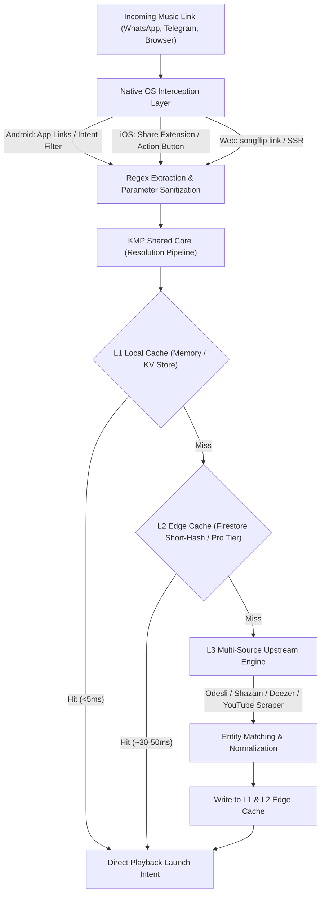
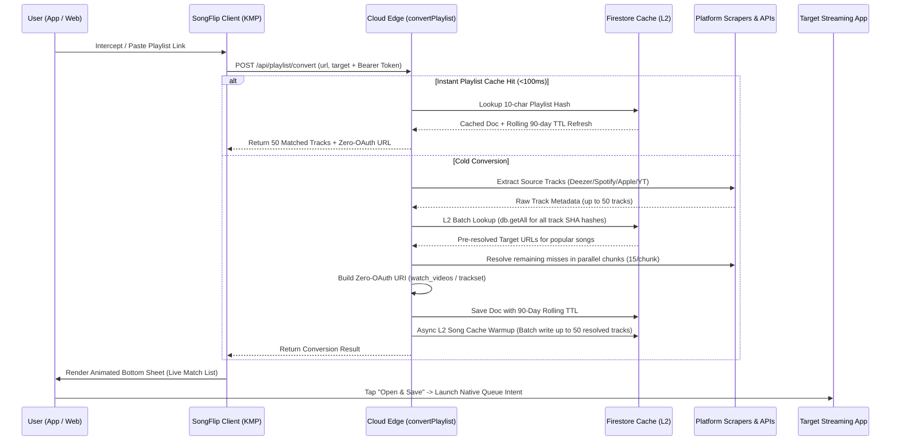

# SongFlip Architecture & Internals 🏛️

This document outlines the technical design, architectural patterns, and resolution pipeline powering **SongFlip**.

SongFlip is designed to solve a simple problem with high engineering rigor: **How to intercept, resolve, and redirect cross-platform music links with sub-50ms latency, zero intermediate UI, and zero user tracking.**

---

## 1. High-Level System Overview

SongFlip operates across three client layers (Android, iOS, Web) backed by a shared Kotlin Multiplatform engine and a serverless edge cache:



---

## 2. The Resolution Pipeline (Step-by-Step)

### Step 1: Deterministic URL Sanitization & Robust Search Normalization
Music streaming services append aggressive tracking clutters to share links (e.g. `?si=...`, `?context=...`, `?utm_source=...`, `intl-*` subdomains).
Before hashing or resolving, the URL is strictly canonicalized:
- Tracking query parameters are stripped.
- Canonical entity types (`track`, `album`, `artist`, `playlist`, `podcast`) and platform IDs are extracted via regex guards.
- Eliminating tracking parameters maximizes cache hit rates across different social networks.
- **Strict Host & Domain Verification (`isHostOrSubdomain`):** URL parsing validates hostnames against explicit service domains (and subdomains) instead of substring matching, preventing spoofed URLs (e.g. `evil-spotify.com`, `notspotify.com`) from triggering matching or query extraction.
- **Search Query & Symbol Sanitization (`cleanSearchQuery`):** Fallback and deep-search queries are automatically sanitized across KMP and backend pipelines—stripping noise tags (`- 2011 Remaster`, `(Radio Edit)`, `[Live]`), disruptive search-breaking symbols (`+`, `&`, `#`, `|`, `/`, `:`, quotes), variation selectors, and emojis (`🎙️`, `🔥`) into clean whitespace. This prevents index failures on strict full-text search engines (such as Pocket Casts, Apple Podcasts, Spotify search operators, Tidal, and Deezer).

### Step 2: Tiered Caching Architecture

| Tier | Technology | Latency | Scope & Invalidation |
|---|---|---|---|
| **L1 (Local)** | In-Memory + SQLDelight ACID SQLite Store (`songflip_store.db`, WAL mode) | `< 5 ms` | Device-only (shared across iOS App Group `group.de.goork.songflip` & Android). Sub-millisecond playback launch for repeated tracks with automatic legacy JSON migration. Resolver hits are fresh for 7 days; conversion history and favorites are retained indefinitely (favorites pinned: up to 10 in Free tier, unlimited in Pro). Always active on all devices. |
| **L2 (Edge Cache)** | Serverless Firestore Edge *(Pro Tier read / Crowdsourced write)* | `~30–50 ms` | Global, indexed via 12-char SHA-256 short hashes (`/resolve` & `/ingest`). Reading is reserved for SongFlip PRO & Web Converter (`songflip.link/s/...`), while background ingestion is crowdsourced across all platforms (Android, iOS, Web). |
| **L3 (Upstream)** | Multi-Provider Aggregator | `~200–500 ms` | Cold fallback only. Queries Odesli, iTunes Search API, Deezer Catalog API, Qobuz Public API, and Shazam REST directly from the client. |

> **Architectural Note on Tiering:** SongFlip's client engine is completely autonomous and operates with 100% functionality on device using L1 + L3 alone. The L2 Edge Cache is an optional, serverless performance tier that eliminates client-side network roundtrips for popular music entities.

### Step 3: Self-Healing & Edge Cases
- **Playlist Entity Interception:** While standard redirect flows focus on single tracks and albums, incoming playlist URLs (`/playlist/...`) are intercepted early and routed to the **Universal Playlist Converter (v1.4+)** bottom sheet in the native client rather than failing (tracked via `playlist_routed`).
- **Dedicated Cross-Platform Podcast Resolution (v1.6+):** Shared podcast episodes and shows (Spotify, Apple Podcasts, YouTube Music, Pocket Casts, Deezer, Amazon Music) are resolved via a dedicated pipeline (`isPodcastUrl()`) using iTunes Lookup API metadata, OpenGraph scraping, serverless L2 caching (`l2_podcast_cache`), and direct deep-search intents (`ResolutionResult.Podcast`), complete with emerald FlipPages and embedded audio playback.
- **Audiobook Interception & Notice:** Due to closed ecosystems and DRM restrictions, audiobooks (e.g. `open.spotify.com/audiobook/...`) are intercepted early (`isAudiobookUrl()`) and short-circuited with a structured explanation (`ResolutionResult.PodcastOrAudiobook`) to prevent 404s or broken redirects.
- **Social Sessions & Personal Profiles (Spotify Blend, Jam, Live, Users):** Non-music session links (such as `open.spotify.com/blend/` or `/jam/`) cannot be converted across providers. SongFlip intercepts these via `isSocialOrSessionUrl()` and seamlessly forwards them directly to the native host app (`ResolutionResult.UnsupportedEntity`), tracking `unsupported_entity_intercepted` instead of error events.
- **Fast-Fail Foreign Domain Interception (v1.9.11 / #132):** When users share social video or generic web links (e.g. `vm.tiktok.com`, `instagram.com/reel/...`, `musiccloud.io`) via the system share sheet, `SongLinkEngine` checks `UrlUtils.isSupportedMusicOrAggregatorUrl(canonicalUrl)` immediately after shortlink expansion. Unrecognized domains short-circuit with `ResolutionResult.UnsupportedEntity(entityType = "unsupported_domain")` without making an upstream API request, display a localized tip pointing to **Listen & Flip**, and forward the original URL without delay while logging `unsupported_entity_intercepted` instead of `link_flip_failed`.
- **YouTube Shorts Normalization:** Shared YouTube Shorts links (`youtube.com/shorts/{id}`) are automatically canonicalized into full video/track links (`music.youtube.com/watch?v={id}`), enabling immediate cross-platform flipping without failure.
- **Self-Titled Albums:** Search APIs frequently map an album name (matching the artist's name) to a single track video instead of the album playlist. SongFlip enforces strict entity type validation (`music.youtube.com/playlist?list=OLAK5uy_...` for albums) to prevent single-video downgrades.
- **Shazam Links:** Apple's Shazam CDN blocks standard user agents with HTTP 405. SongFlip leverages the internal discovery REST endpoint (`amp.shazam.com/discovery/v5/...`) with native headers to retrieve clean Apple Music and ISRC identifiers without auth.
- **Offline Buffering & Intermittent Network Resilience (v1.4.15+):** When a user taps a music link during low or missing connectivity (e.g. subway tunnels, elevators, dead zones), SongFlip does not crash or fail with dead-end error toasts. The native layer registers a reactive network state listener (`NetworkUtils.observeNetworkState()`). An animated bottom sheet (`OfflineWaitingBottomSheet`) holds the parsed entity intent, displays real-time connection status with auto-retry, and executes the resolution pipeline the instant `NET_CAPABILITY_INTERNET` and `NET_CAPABILITY_VALIDATED` are restored—launching target playback seamlessly.
- **Regional Domains & Morphe/ReVanced:** On Android, custom modded packages (e.g. `app.morphe.android.apps.youtube.music`, `app.revanced.android.apps.youtube.music`, `app.rvx...`) are prioritized and regional Amazon Music domains (`music.amazon.de`, `music.amazon.co.uk`) are dynamically supported.
- **Dedicated Player Isolation & Paywall-Free Web Fallback (v1.5.2):** Installed player detection strictly isolates dedicated streaming apps (e.g. YouTube Music, ViMusic, RiMusic vs. standard YouTube video players). If a target streaming app is not installed on the device, SongFlip converts the specialized web URL (e.g. `music.youtube.com/watch?v=...`) via `UrlUtils.toWebFallbackUrl()` to standard `youtube.com/watch?v=...` before browser dispatch. This completely avoids mobile landing paywalls ("Music Premium 1 month free") and ensures immediate, unrestricted playback in standard video players or mobile browsers.

### Step 4: Cross-Platform Entity Mapping & Graceful Fallback Strategy

SongFlip enforces deterministic 1:1 entity mapping across streaming platforms:
- **Track $\rightarrow$ Track:** Direct playback launch (`autoplay` / native deep-link intent).
- **Album $\rightarrow$ Album:** Direct album view (playlist / collection ID).
- **Artist $\rightarrow$ Artist:** Direct artist profile page.
- **Podcast $\rightarrow$ Podcast:** Direct show/episode deep search and launch (`podcast://`, `spotify:search:`, `pocketcasts://`).
- **Playlist $\rightarrow$ Playlist:** Universal batch conversion with Zero-OAuth queue import (up to 200 tracks with multi-chunking & deduplication).

When an upstream resolver (e.g. Odesli) lacks a mapping for a target platform (frequent with regional identifiers such as Amazon Music ASINs), SongFlip applies a tiered fallback rather than failing hard:

1. **Secondary Auth-Free API Resolvers with Strict Similarity Matching (`ResolverUtils`):**
   - **Apple Music:** iTunes Search API queries collection/track IDs with strict title/artist token overlap verification (rejecting false-positive compilations).
   - **Deezer:** Deezer Public Search API resolves direct album/track URLs with fuzzy name matching.
   - **Tidal:** Tidal Public Search API queries direct track/album IDs with token consistency checks.
   - **Qobuz:** Qobuz Public Catalog API resolves direct track, album, and artist IDs with strict title/artist similarity validation.
   - **YouTube Music:** YouTube Music scraper resolves `browse/MPREb_...` album IDs and `watch?v=...` video IDs.
2. **Deterministic Search Fallback (Graceful Degradation):**
   Platforms without open, auth-free public search APIs (**Amazon Music**, **Spotify**, **SoundCloud**, **Bandcamp**, **Beatport**, **Pocket Casts**) or when candidate metadata diverges significantly gracefully fall back to pre-populated search deep-links (e.g. `amznmp3://music.amazon.com/search/<Artist>+<Album>`, `spotify:search:...`, `soundcloud://search?q=...`, `podcast://...`). This guarantees that the user always lands on the desired content with zero dead-ends and zero wrong-track misdirects.

| Target Platform | Track Intent | Album Intent | Artist Intent | Podcast Intent | Secondary Lookup | Miss Fallback |
| :--- | :--- | :--- | :--- | :--- | :--- | :--- |
| **YouTube Music** | `watch?v=` | `browse/MPREb_...` / `playlist?list=` | `channel/UC...` | `search?q=` | ✅ YouTube Scraper | `music.youtube.com/search?q=` |
| **Apple Music / Podcasts** | `/song/<id>` | `/album/<id>` | `/artist/<id>` | `podcast://podcasts.apple.com/search` | ✅ iTunes API | `music.apple.com/search?term=` |
| **Deezer** | `deezer://.../track/` | `deezer://.../album/` | `deezer://.../artist/` | `deezer.com/search/` | ✅ Deezer API | `deezer.com/search/` |
| **Pocket Casts** | — | — | — | `pocketcasts://search?q=` | ❌ None (Search intent) | `play.pocketcasts.com/podcasts/search?q=` |
| **Spotify** | `spotify:track:<id>` | `spotify:album:<id>` | `spotify:artist:<id>` | `spotify:search:<query>` | ❌ None (OAuth-only) | `spotify:search:<query>` |
| **Amazon Music** | `amznmp3://... ?trackAsin=` | `amznmp3://.../albums/<ASIN>` | `amznmp3://.../artists/<ASIN>` | `music.amazon.com/search/` | ❌ None (ASIN regional) | `amznmp3://music.amazon.com/search/` |
| **Tidal** | `tidal://track/<id>` | `tidal://album/<id>` | `tidal://artist/<id>` | — | ✅ Tidal Public API (`api.tidal.com`) | `listen.tidal.com/search?q=` |
| **SoundCloud** | `soundcloud://sounds:<id>` | `soundcloud://sets:<id>` | `soundcloud://users:<id>` | — | ❌ None (Web only) | `soundcloud://search?q=` |
| **Bandcamp** | `bandcamp://...` | `bandcamp://...` | `bandcamp://...` | — | ❌ None (Web only) | `bandcamp.com/search?q=` |
| **Qobuz** | `qobuz://open.qobuz.com/track/<id>` | `qobuz://open.qobuz.com/album/<id>` | `qobuz://open.qobuz.com/artist/<id>` | — | ✅ Qobuz Public API | `play.qobuz.com/search?q=` |
| **Beatport** | *(Source only)* | *(Source only)* | *(Source only)* | — | ✅ Beatport OG Scraper | `beatport.com/search?q=` |

---

## 3. Universal Playlist Conversion Architecture (Zero-OAuth Pipeline)

SongFlip includes a high-performance **Universal Playlist Converter** operating without requiring user account credentials or OAuth authorizations:



### Core Playlist Pipeline Components:
1. **Extraction Scrapers:** Zero-auth extraction for Deezer API (`/playlist/{id}`), Spotify embed scraper, YouTube Music initial page data, and Apple Music meta tags.
2. **L2 Batch Cache Acceleration:** Evaluates all track URLs simultaneously via a single Firestore batch lookup (`db.getAll(...docRefs)`) to reuse previously resolved single-track mappings in `<50ms`.
3. **Parallel Chunk Matching:** Resolves remaining cache misses in concurrent chunks (15 at a time) via target search scrapers and iTunes API.
4. **Zero-OAuth Queue Generation:**
   - **YouTube Music:** Resolves `www.youtube.com/watch_videos?video_ids=...` via HTTP 303 location redirection into a direct `music.youtube.com/watch?v={id}&list=TLGG...` queue playlist, with intelligent direct-track fallback (`music.youtube.com/watch?v={firstId}`) to prevent automated bot traffic blocks.
   - **Spotify:** Generates `spotify:trackset:{Title}:{id1},{id2}...` URI schemes.
5. **Multi-Chunk Scaling (up to 200 tracks), Deduplication & File Export (v1.8.0+):** Extended beyond the 50-track limit to handle large playlists with up to 200 songs.
   - **Track Deduplication:** Case- and whitespace-insensitive deduplication removes duplicate titles before matching.
   - **Part Chunking (`PlaylistChunk`):** Automatically segments large playlists into 50-track sub-queues (`Part 1`, `Part 2`...), each playable with a single tap in YouTube Music and Spotify.
   - **Universal File Export:** Generates Extended M3U8 (`audio/x-mpegurl`) and RFC 4180 CSV files directly on-device for desktop media players and cloud libraries.
6. **SSR Web Sharing (`songflip.link/s/...` & `songflip.link/p/...`) & oEmbed 1.0 (`/api/oembed`):** Server-rendered, localized web pages with strict CSP hardening, CDN edge-cache resilient client-device prioritization (synchronous DOM reordering via `navigator.userAgent` ensuring visitors on Android see YouTube Music & Spotify first while iOS/macOS users see Apple Music first, even when pages are globally cached at the edge), embedded 30-second audio previews (`og:audio` / `og:audio:secure_url`), oEmbed 1.0 JSON discovery (`<link rel="alternate" type="application/json+oembed">`), and built-in scannable QR code generator modals (with in-app QR code generation in history strictly scoped to Pro users without disruptive paywall prompts for free users).
7. **90-Day Rolling TTL Lifecycle:** Playlist records are saved with an `expiresAt` timestamp and automatically refreshed on every web page view or conversion hit. Unused playlists expire cleanly via Firestore TTL policies.
8. **Automatic L2 Song Cache Swarm Warmup:** Every playlist conversion asynchronously writes all successfully resolved tracks into the global Firestore `l2_song_cache` (with canonical 12-char SHA-256 short-hash single-write indexing). This automatically seeds the global cache, guaranteeing sub-30ms instant resolutions for any user subsequently flipping these tracks individually.

---

## 4. Kotlin Multiplatform (KMP) Architecture

The codebase separates platform-specific UI from deterministic platform-agnostic business logic:

```text
├── app/                  # Native Android App (Jetpack Compose, MVVM ViewModels, Material 3, Quick Settings Tile)
├── iosApp/               # Native iOS App (SwiftUI, Share Extension, App Intents)
├── shared/               # Kotlin Multiplatform Core (Shared by Android & iOS)
│   ├── commonMain/       # Shared URL sanitizers, SQLDelight cache manager, HTTP engine (Ktor), models
│   ├── androidMain/      # Android SQLDelight driver, Keystore coupon storage & PackageUtils
│   └── iosMain/          # iOS NativeSqliteDriver, Keychain coupon storage & XCFramework export
└── functions/            # Firebase Cloud Functions (TypeScript edge proxy, SSR landing pages, Ed25519 vouchers)
```

### Shared Logic Benefits:
- **Unified Engine (v1.4.7+)**: Both Android and iOS run 100% on the identical `SongLinkEngine.shared` and `LinkCache` core. Legacy redundant Android networking and repository layers were completely eliminated.
- **Consistent Resolver Behavior:** Both platforms share identical regex rules and parsing priority. A song resolved on Android resolves identically on iOS.
- **Zero Drift:** Bug fixes, URL parsing rules, and caching invariants only need to be written and unit-tested once in `shared/commonMain`.

### Android Architecture: MVVM & Reactive StateFlow (v1.6.4+):
- **ViewModel Decoupling:** Activities and Composables (`RedirectActivity`, `MainActivity`) delegate all business logic, preference mutations, and asynchronous I/O to dedicated ViewModels (`RedirectViewModel`, `MainViewModel`).
- **Reactive State Observation:** UI components observe immutable states exposed as `StateFlow` via `collectAsStateWithLifecycle()`, guaranteeing safe state recreation and preventing leaks during configuration changes or background transitions.

### Concurrency Invariant: Strict Structured Concurrency:
- **`CancellationException` Re-Throwing:** In Kotlin Coroutines, `CancellationException` is a subtype of `Exception` / `Throwable`. All shared engines (`PlaylistConverterEngine`, `SongLinkEngine`, `CatalogSearchEngine`, `PromoBannerManager`, `CouponService`, `AptabaseClient`) and platform resolvers (`SpotifyResolver`, `AppleMusicResolver`, `DeezerResolver`, `TidalResolver`, `QobuzResolver`, `YouTubeMusicResolver`, `SongLinkApiResolver`) strictly re-throw `CancellationException`. This ensures parent coroutine scopes cancel cleanly, preventing orphaned HTTP jobs and deadlock states when redirects are dismissed.

### UI/UX Invariant: 5-State Component Contract & WCAG AA:
- **5 Component States:** All interactive sheets and UI controls (`QuickTargetPickerBottomSheet`, `OfflineWaitingBottomSheet`, `SetupCard`) explicitly support 5 visual states: *Default*, *Hover*, *Active/Focus*, *Disabled*, and *Loading* (with inline progress spinners).
- **Accessible Touch Targets:** All tap targets conform to WCAG AA guidelines with a minimum height and width of 48dp (`Modifier.heightIn(min = 48.dp)`).

### Backend Reliability Invariant: No Silent Failures:
- All Cloud Functions catch blocks strictly prohibit silent discarding (`catch (_) {}`). Any caught non-fatal exception (e.g. background TTL refresh failure or secondary preview lookup miss) is logged with structured diagnostic context (`console.warn`) for seamless production observability.

### iOS Native Share Extension & App Groups:
The iOS architecture decouples the main user interface (`de.goork.SongFlip`) from the background system extension (`de.goork.SongFlip.ShareExtension`):
- **App Group Container (`group.de.goork.songflip`)**: Provides shared IPC storage via `UserDefaults(suiteName:)` for lightweight preferences (`target_platform`, `custom_api_url`, `is_pro_cached`) and a shared SQLDelight SQLite database (`Library/Application Support/songflip_store.db` in WAL mode) for transactional conversion history, favorites, and L1 resolver caching.
- **Static KMP Linking**: The KMP framework (`SongFlipKit.xcframework`) is linked statically (`isStatic = true`) into both the main application and the extension bundle, preventing runtime dynamic library lookup issues across extension boundaries.
- **Zero-Friction Sharing**: The extension intercepts incoming URLs or text from any host app (Spotify, Apple Music, Safari, WhatsApp), resolves the target stream in the background via `SongLinkEngine`, awaits the transactional history write to the shared SQLDelight database, and directly triggers playback in the target player.
- **Unified In-App Purchases & RevenueCat Architecture (`ProManager.kt` & `ProManager.swift`)**: Uses RevenueCat on both platforms (Android: Google Play Billing Library 8+ via `com.revenuecat.purchases:purchases`; iOS: StoreKit 2 via Purchases v5 SPM) to manage subscriptions (`songflip_pro_annual`, `songflip_pro_monthly`) and non-consumable lifetime purchases (`songflip_pro_lifetime`). Supports 7-day free trial on annual subscriptions, dynamic 50% discount promotions, offline coupon verification via `/redeemPromoCode`, and cross-process App Group entitlement caching on iOS.
- **Dynamic Remote Paywall Layouts (`PaywallPricing.kt` / `PaywallPricing.swift`)**: Dynamically resolves paywall card ordering and pre-selection from RevenueCat Offering metadata (`paywall_layout`: `annual_first` vs. `lifetime_first`), with mathematical discount savings computation (`annualSavingsPercent`) resilient to currency variations.
- **Offline Cryptographic Entitlement Security**: Fortified local offline Pro entitlement persistence with cryptographic HMAC-SHA256 signature verification (`pro_cache_signature`) bound to hardware vendor UUIDs to prevent plaintext privilege escalation.
- **Interactive Playlist & History Parity**: Full feature parity with Android via native SwiftUI components: `PlaylistConverterView` (live progress, match detection, Zero-OAuth queue launch for Spotify/YouTube Music, 5-song free limit gating), `HistorySheetView` (10 free / 100 PRO capacity indicator), and `FeedbackSheetView` (zero-tracking Firestore feedback with mail fallback).
- **Search & History Ergonomics Architecture (v1.8.10)**: Fast-Flip 1-tap playback from cover and card taps, unified 3-dot overflow menu for sharing, QR code generation (PRO-only gating), alternative player selection, and automatic keyboard dismissal on list scrolling.
- **Hardening, Resilient Logging & Localization Architecture (v1.8.11)**: Replaced silent exception suppression across network, package manager, and platform cache layers with structured diagnostic logging; fortified local offline Pro entitlement persistence with cryptographic HMAC-SHA256 signature verification (`pro_cache_signature`); completed 31-language parity on iOS (`LocalizationManager.swift`); and ensured consistent interactive player fallback routing.
- **Shortlink Pre-Resolution & Telemetry Decoupling (v1.8.12)**: Deferred Deezer playlist classification until after HTTP redirect resolution (ensuring single tracks shared via `link.deezer.com` resolve directly instead of prematurely routing to the playlist converter); decoupled playlist conversion failures from single-song telemetry (`link_flip_failed`) to prevent KPI distortion; introduced actionable diagnostic callout cards for private/restricted playlists on Android and iOS; and established a strict 495-char/byte gate with zero-newline exports for Google Play release note pipelines.
- **Playlist Conversion Execution Budget & Partial-Match Resilience (v1.8.13 / Invariante 65)**: Cloud Function `convertPlaylist` enforces a strict 45-second execution deadline for batch track matching. If upstream APIs exceed latency limits, chunk matching breaks gracefully and returns all resolved songs as a working partial playlist (`isPartial: true`, HTTP 200) instead of throwing an unrecoverable 60-second gateway timeout. 50ms chunk pacing eliminates 429 rate limiting against YouTube/Spotify scrapers. Android KMP (`PlaylistConverterEngine.kt`) and iOS (`PlaylistConverterView.swift`) timeout budgets are unified to 45s (primary) and 55s (fallback) for large/Pro playlists, with structured `UPSTREAM_TIMEOUT` diagnostics.
- **Data Retention & Fail-Closed Hardening (v1.8.14)**: `LinkCache` separates resolver freshness (7-day TTL) from user data retention (history and favorites kept indefinitely, favorites pinned forever and excluded from the `maxEntries` LRU and the Android 500-entry prune); `put()` preserves the favorite flag on re-flip. iOS `HistoryModel` backs up undecodable history blobs to `songflip_conversion_history_corrupt_backup` before any overwrite and logs via `os.Logger`. iOS foreground refresh runs through a single `scenePhase` hook. Backend admin endpoints use `getAdminSecret()` and fail closed when `ADMIN_SECRET` is unset (no hardcoded fallback). Android coupon redemption closes OkHttp responses via `use {}` and warm-up calls run on a scoped `SupervisorJob`.
- **Entitlement Verification & Origin Hardening (v1.8.15)**: iOS clients transmit `Authorization: Bearer <authToken>` for playlist conversion and L2 cache queries (`ProManager.swift`, `PlaylistConverterView.swift`, `ContentView.swift`). Backend `verifyProStatus` and Android `ProManager.kt` enforce strict entitlement checks (`pro` or `songflip_pro` entitlement only, preventing accidental lifetime grants from unrelated consumables). Coupon authorization accepts exclusively cryptographically signed `sct_...` device tokens, eliminating raw campaign name bypasses. The L2 cache endpoint enforces a strict origin whitelist (`ALLOWED_ORIGINS = Set(["https://songflip.link", ...])`), eliminating origin-spoofing bypasses.
- **Resilience, Telemetry Parity & Concurrency Safety (v1.8.16)**: `AptabaseClient.kt` uses Mutex synchronization for session ID and timestamps, and provides `trackEventAwait` with timeout and `flush()` for short-lived extensions. iOS `ShareViewController.swift` and `ConvertSongIntent.swift` establish full telemetry parity with Android and flush events before process termination. Android `ProManager.kt` caches active Pro state in local SharedPreferences for instant offline hydration and preserves Pro entitlements during network timeouts. Backend `proVerification.ts` only caches `false` on explicit 404, never polluting the cache on transient 5xx/timeouts. iOS `HistoryModel.swift` performs a fresh `reloadFromDefaults()` before every mutating operation (`add`, `updateItem`, `delete`, `clear`) to guarantee read-modify-write safety against concurrent Share Extension writes.
- **Coupon Parity, xcconfig Configuration & Logging Hygiene (v1.8.17)**: iOS `ProManager.swift` implements parity with Android coupon redemption: conversational and URL code cleaning (`extractCouponCode`), multi-endpoint failover (`cache.songflip.link` -> `songflip-web.web.app`), and distinct error taxonomy (`rateLimited`, `maxReached`, `inactive`) mapped to localized user feedback. Public SDK and telemetry keys (`REVENUECAT_PUBLIC_KEY`, `APTABASE_APP_KEY`, `APTABASE_HOST`) moved out of hardcoded source literals into Xcode configuration settings (`SongFlip.xcconfig`, gitignored `Config.xcconfig`, `Config.example.xcconfig`) with explicit debug diagnostics. Silent `try?` resolution in `ShareViewController.swift` and `ConvertSongIntent.swift` replaced with structured `do/catch` capturing detailed failure reasons and network categories for telemetry. Raw `print` calls replaced across the codebase with Apple Unified Logging (`os.Logger`).
- **SoundCloud Target Player, oEmbed Social Previews, Persistent `installId` & Strict Server-Side Quota Verification (v1.8.18)**: Added SoundCloud (`Platform.SOUNDCLOUD`, `BrandSoundCloud #FF5500`) as a full target player across Android and iOS (Main app, Quick Target Picker, Share Extension, Link Diagnosis) with native `soundcloud://search?q=` deep-link conversion and localized catalog hint banner across 31+ languages. Added oEmbed 1.0 endpoint (`GET /api/oembed?url=...&format=json`), `<link rel="alternate" type="application/json+oembed">`, and `og:audio` / `og:audio:secure_url` / `og:audio:type` meta tags to song and playlist SSR landing pages (`renderWebShare`, `renderPlaylistWebShare`). Stabilized device `installId` across app reinstalls via iOS Keychain (`kSecClassGenericPassword`, `de.goork.songflip.install`) and Android `Settings.Secure.ANDROID_ID` (with emulator bug ID filtering and UUID fallback). Removed the legacy `(isSongflipApp && isPro === true)` body flag bypass in `convertPlaylist` (`playlist.ts`) and removed `isPro` from client request payloads (`PlaylistConverterEngine.kt`, `PlaylistConverterView.swift`), enforcing strict cryptographic `isProVerified` validation.
- **SQLDelight Transactional Store, Full KMP Engine Unification, Cross-Platform Favorites & Ed25519 Coupon Security (v1.9.0)**: Replaced legacy JSON-blob storage in `SharedPreferences` / `NSUserDefaults` with a transactional SQLDelight SQLite database (`SongFlipDatabase.sq`, `SqlDelightCacheStorage.kt`) in `:shared` configured with `PRAGMA journal_mode=WAL` and `PRAGMA busy_timeout=5000` for multi-process safety across the iOS Main App, Share Extension, and Siri App Intents (`group.de.goork.songflip/Library/Application Support/songflip_store.db`), including automatic one-time migration of legacy history and L1 resolver entries. Brought full favorites parity to iOS (`HistorySheetView.swift`, `HistoryModel.swift`) with star buttons, filter chips (`All` / `Favorites`), and a unified Freemium limit (up to 10 pinned favorites in Free, unlimited in Pro). Eliminated redundant iOS networking in `SearchSheetView.swift`, `DisambiguationSheetView.swift`, `PlaylistConverterView.swift`, and `ProManager.swift` by routing all requests through shared KMP engines (`CatalogSearchEngine`, `DisambiguationEngine`, `PlaylistConverterEngine`, `CouponService`). Upgraded promo coupon tokens from symmetric HMAC to asymmetric Ed25519 signatures (`sct_v2_<payload>.<sig>`, RFC 8032 `Ed25519Verifier.kt`), stored encrypted in Android Keystore AES-GCM and iOS Keychain, with strict device `installId` binding and monotonic `lastSeenServerTime` clock-rollback protection.
- **Gradle Version Catalog & Qobuz / Beatport Streaming Integration (v1.9.1)**: Migrated dependency management to `gradle/libs.versions.toml` and added full support for Qobuz (source & target player with Hi-Res deep-links and `QobuzResolver`) and Beatport (source recognition and DJ/Club release extraction).
- **RevenueCat Custom Paywall Impression Telemetry & Format Specifier Hardening (v1.9.2)**: Integrated native `trackCustomPaywallImpression()` across Android and iOS for accurate A/B experiment exposure tracking, unified paywall entry-point telemetry, and standardized format specifiers across all localized strings.
- **End-to-End Resolution & Cache Hardening, Qobuz/Beatport Parity & Full Localization Completeness (v1.9.3)**: Enforced strict null-return semantics in `SongLinkEngine.resolveDirectPlatformUrl` so raw-query fallback retries and `_search` platform tagging operate deterministically; extended `DisambiguationEngine`, clipboard detection, and the iOS Share Extension to cover Qobuz, Beatport, and Shazam; guaranteed legacy Android `SharedPreferences` migration before cache version cleanup and preserved permanent SQLite history entries during in-memory LRU eviction; enforced standard system TLS validation on iOS and strict `sct_v2_` Ed25519 coupon verification; and achieved 100% translation key parity across all 31 Android and 28 iOS locales.
- **Acoustic Music Recognition ("Listen & Flip") & Offline Club Mode Architecture (v1.9.5–v1.9.9)**: Integrated in-app acoustic music recognition across Android (`AcousticRecognizer.kt`, `ListenAndFlipBottomSheet.kt`) and iOS (`AcousticRecognizer.swift`, `ListenAndFlipSheetView.swift`) backed by a shared KMP quota, resolution, and offline-queue manager (`AcousticQuotaManager.kt`). On Android, `AudioRecord` captures 48 kHz (with 44.1 kHz / 16 kHz fallback) 16-bit mono PCM using `AudioSource.VOICE_RECOGNITION` (mandated by Android CDD Section 5.4.2 to disable OEM HAL speech-isolation DSP and preserve flat ambient frequency response, with runtime fallback to `CAMCORDER` and `MIC` if dead silence is detected) and applies software Automatic Gain Control (`applySoftwareAgcAndRms`) to normalize quiet ambient speaker audio into `libsigx.so`'s optimal spectral peak range before feeding a single thread-safe `SignatureGenerator`. Progressive snapshots at 3.2s, 6.2s, 9.2s, and 12.0s are matched directly against `https://api.shazam.apple.com/v1/catalog/{storeFront}/match` via `OkHttpClient` + `JSONObject` (`matchSignatureBase64Direct`, authenticated via cached ES256 JWT from `/getShazamToken`), eliminating R8/Retrofit/Gson reflection hazards and concurrent `SigX` native state contention. On iOS, `AVAudioEngine` downmixes multi-channel mic buffers to mono float32 with software AGC and matches via `SHSession` alongside progressive direct REST catalog snapshots. Both platforms display dynamic volume guidance (`listen_status_hint`) only when the microphone signal remains genuinely quiet after 3 seconds (`elapsedSeconds >= 3 && amplitude < 0.20`). Recognized tracks resolve to the user's preferred target platform via `SongLinkEngine.resolveTargetUrl(..., isPrefetch = true)` and persist as a single canonical `history_entry` (`is_acoustic = 1`, with `UrlUtils.normalizeUrl` enforced in `LinkCache.buildKey` and automatic self-healing deduplication in `LinkCache.collectDeduplicatedHistoryItems`). `AcousticQuotaManager` grants 3 free successful scans/month, never deducts failed/cancelled attempts, and skips quota deduction when a recognized track is already present in the user's history (`hasMatchingHistoryEntry`). When offline, Pro users capture 6-second acoustic signatures into the SQLDelight `pending_acoustic_scan` queue (`Offline Club Mode`), which automatically matches and resolves in the background as soon as connectivity returns.
- **Playlist History Refresh, Entitlement Cold-Start Grace & Auth Token Prioritization (v1.9.10)**: `ProManager.getAuthToken()` (Android) and `ProManager.authToken` (iOS) prioritize active RevenueCat store entitlements (`Purchases.sharedInstance.appUserID`) and validate stored coupon tokens via `CouponService.verifyCouponOffline` before returning `"coupon:..."`, preventing expired promotional vouchers from shadowing active Google Play or App Store subscriptions. Local cold-start entitlement hydration (`hydrateLocalProState` / `loadCachedState`) applies a 15-minute renewal grace window (`RC_EXPIRY_GRACE_MS`) around `rc_pro_expires_ms` so background share-sheet intents (`RedirectActivity` -> `MainActivity`) do not transiently drop to the 5-track free tier while asynchronous store renewal completes. `PlaylistConvertBottomSheet` observes `externalConversionState` transitions alongside `isPro` to automatically re-trigger conversion (`forceRefresh = true`) if an initial cold-start conversion returned `isLimited = true`. Refreshing a playlist entry in History (`HistoryBottomSheet.kt` / `HistorySheetView.swift`) routes directly through `PlaylistConverterEngine.convertPlaylist(..., forceRefresh = true)`—bypassing the 7-day Firestore playlist cache and updating the saved history entry and matched/total song counter (`maxOf(totalTracks, originalTotalTracks)`) in place.
- **Foreign URL Fast-Fail Interception & Production Purchase Telemetry Hygiene (v1.9.11)**: `UrlUtils.isSupportedMusicOrAggregatorUrl` validates canonical URLs against supported streaming platforms, podcasts/audiobooks, and music aggregators (`song.link`, `album.link`, `odesli.co`, `shazam.com`). Foreign domains shared via Android `ACTION_SEND` or iOS Share Extension / App Intents fast-fail immediately with `ResolutionResult.UnsupportedEntity(entityType = "unsupported_domain")`, avoiding unnecessary upstream requests, displaying a localized Listen & Flip hint (`unsupported_domain_toast` across all 34 languages), and logging `unsupported_entity_intercepted` (`source_domain`) instead of `link_flip_failed`. Store purchase callbacks in `ProManager.kt` / `ProPaywallBottomSheet.kt` and `ProManager.swift` inspect `entitlement.isSandbox` and only emit `pro_purchased` to Aptabase for production transactions (`isSandbox == false`).
- **Audiophile Quality Matcher & Studio Master Prioritization (v1.10.0 / #85)**: Introduced an optional PRO preference (`audiophile_mode` across Android `SettingsRepository` and iOS App Group `UserDefaults` `group.de.goork.songflip`) that prioritizes high-resolution studio masters over generic aggregator links. When `isPro && audiophileMode` is active for audiophile-capable targets (`tidal`, `qobuz`, `appleMusic`, `deezer`), `SongLinkEngine` bypasses generic L2 cache matches and executes candidate scoring via `ResolverUtils.scoreAudiophileCandidate(...)` across `TidalResolver` (`api.tidal.com/v1/search` inspecting `audioQuality`, `audioModes`, `mediaMetadata.tags`, `version`, and `album.title`), `QobuzResolver` (`hires`, `hires_streamable`, `maximum_bit_depth`, `maximum_sampling_rate`, `tracks_count`), `AppleMusicResolver` (`collectionArtistName`, `trackCount`, `discCount`), and `DeezerResolver` (`titleVersion`, `album.title`). The scoring algorithm rewards 24-bit Hi-Res, Spatial/Dolby Atmos, Lossless, and multi-track studio albums while penalizing radio edits, "Various Artists" compilations, unrequested remixes/live versions, and tribute/cover bands, falling back to Odesli's canonical link if no verified candidate matches.
- **Legacy UUID Coupon Compatibility & Self-Healing Re-Redemption (v1.10.1)**: Before `v1.8.18`, `ProManager.getAnonymousInstallId()` generated a random UUID in `SharedPreferences("anonymous_install_id")` before `Settings.Secure.ANDROID_ID` (`stableAndroidId`) was prioritized. `ProManager.verifyStoredCouponOffline` (Android & iOS) now validates stored tokens against both the primary hardware `installId` and any legacy `anonymous_install_id` / `identifierForVendor` stored on the device so pre-`v1.8.18` coupons remain valid across updates. Additionally, `redeemPromoCode` in Cloud Functions supports self-healing re-redemption for the same device without consuming an extra redemption slot.
- **Effective Launch Target Resolution & Entity-Aware Player Fallback (v1.10.2)**: `PackageUtils.resolveEffectiveLaunchTarget` centralizes target URI and package resolution across all Android launch paths (`RedirectActivity`, `HistoryBottomSheet`, `SearchBottomSheet`, `DisambiguationBottomSheet`, `ListenAndFlipBottomSheet`, `PlaylistConvertBottomSheet`). Extended preferred player selection (`SettingsRepository.getPreferredPlayerPackage` / `setPreferredPlayerPackage`, `PlayerPickerBottomSheet`, `TargetSelectorCard`) to cover both `youtubeMusic` (including `com.music.bitchord` / `com.dev.bitchord`) and `tidal` (`com.aspiro.tidal` and `com.eclipse.android`). When `com.eclipse.android` is resolved as the active Tidal handler, single-track URLs are converted to `debridmusic://play/tidal/<id>` (`PackageUtils.toEclipseTidalUri`), while non-track entities (albums, artists, playlists) that are not supported by the `debridmusic://` deep-link handler automatically fall back to the official `com.aspiro.tidal` app (`tidal://...`) if installed or to the web browser (`https://...`) otherwise. Additionally, lifetime coupon tokens (`sct_v2_`) normalize missing expiration timestamps to `e: 0` across server and client (`CouponService.kt`) with safe `JsonNull` handling.
- **System-Level Listen & Flip Quick Access, Transparent Overlay & Ambient Noise-Gate Tuning (v1.10.3)**: Added instant system entry points for **Listen & Flip** across Android and iOS (available to all users, utilizing `AcousticQuotaManager`'s 3 free recognitions/month and seamless in-sheet PRO upgrade flow). On Android, `ListenAndFlipTileService` (`android.service.quicksettings.TileService`) and the top-ranked (`Rank(0)`) dynamic launcher shortcut (`ShortcutHelper.ACTION_LISTEN_AND_FLIP`) launch `ListenAndFlipActivity` (`Theme.SongFlip.Transparent`, `singleInstance`, `excludeFromRecents="true"` without `noHistory="true"` so runtime `RECORD_AUDIO` permission dialogs do not prematurely terminate the activity). `ListenAndFlipActivity` renders `ListenAndFlipBottomSheet` directly over the user's current screen and finishes with zero transition animation on dismissal. On iOS, `AppDelegate` & `SceneDelegate` register a localized Home Screen Quick Action (`de.goork.songflip.listen`), while `ListenAndFlipIntent` (`openAppWhenRun = true`) and `SongFlipShortcuts` (`AppShortcutsProvider`) expose 1-tap recognition to the iPhone Action Button, Control Center, Siri, and Spotlight, signaling `ContentView` via `group.de.goork.songflip` (`pending_open_listen_sheet`) and `NotificationCenter` (`.openListenAndFlip`). Additionally, `AcousticRecognizer` (Android & iOS) refines the software AGC noise gate (`maxAbs >= 45` / `~-57 dBFS`, max gain capped at `28x`/`24x`) and starts the first catalog snapshot at `3.6s` (`3_600L` ms) so faint background noise or humming does not trigger false-positive catalog collisions.
- **Ed25519 Point Decompression Fix, Paywall Ergonomics, L2 Search Self-Healing & BitChord Deep-Link Hardening (v1.10.4 / #134, #135, #136)**: Fixed a single-nibble constant typo in `Ed25519Verifier.kt` (`I_CONST[9] = 0x3dfb` instead of `0x3df3` for $\sqrt{-1} \pmod p$ per RFC 8032 / TweetNaCl) that caused `unpackNeg(q, publicKey)` point decompression to reject tokens signed with public keys whose $y$-coordinate requires the $\sqrt{-1}$ square-root branch (`045623e9...`); simultaneously updated backend `getCouponEd25519KeyPair()` (`functions/src/security.ts`) to sign with the pinned compatibility keypair (`6949b9c7...`, which decompresses on the primary $\beta^{(p+3)/8}$ branch without touching `I_CONST`) and updated `redeemPromoCode` (`functions/src/index.ts`) to re-sign existing redemptions so already-installed `v1.9.0`–`v1.10.3` clients immediately accept all promo codes. Refined `ProPaywallBottomSheet.kt` (sticky header outside scroll container, `.imePadding()` + auto-scroll on coupon expansion, and splitting compound `"•"` lifetime badges into single-line badge + subtitle on Android and iOS `ProPaywallSheetView.swift`). Completed L2 server-cache `/search`-fallback self-healing and `stripEditionSuffix` parity across `SongLinkEngine.kt`, `DeezerResolver.kt`, `TidalResolver.kt`, `AppleMusicResolver.kt`, and `YouTubeMusicResolver.kt` (#135). Hardened Android YouTube Music / BitChord routing (`PackageUtils.normalizeAndroidYouTubeMusicUri`, preventing iOS-only `youtubemusic://` schemes on Android and classifying `music.youtube.com/browse/MPREb_...` and `list=OLAK5uy_...` as albums in `UrlUtils.kt`, #136). Split Listen & Flip telemetry into `acoustic_scan_matched` and `acoustic_scan_no_match` and suppressed automated test-harness / Firebase Test Lab / Simulator telemetry (#134).
- **Catalog Search Deduplication & Dynamic Multi-Player Client Discovery across All 10 Services (v1.10.5 / #137, #139)**: Upgraded `CatalogSearchEngine` (`CatalogSearchEngine.kt`) to fetch up to `2 * limit` (min 50) raw candidates from iTunes and Deezer and deduplicate identical tracks across compilations, Greatest Hits collections, and remastered re-issues via `normalizeDedupKey` (`artist` + `ResolverUtils.stripEditionSuffix(title)` with remaster/feat suffix stripping), replacing compilation duplicates in-place with canonical studio album releases and returning up to 35 unique tracks to Android (`SearchBottomSheet.kt`) and iOS (`SearchSheetView.swift`). Generalized preferred player selection (`SettingsRepository.getPreferredPlayerPackage`, `PackageUtils.getInstalledPlayersForPlatform`, `TargetSelectorCard.kt`, `SettingsBottomSheet.kt`) across all 10 streaming services by combining static `fallbackPackages` (expanded with *Metrolist*, *OuterTune*, *Kreate*, *Harmony Music*, *Gyawun*, *Spotube*, *Spotify Lite*, *Cider*, *Murglar2*, and *NewPipe / Tubular / PipePipe* for SoundCloud & Bandcamp) with dynamic `queryIntentActivities` discovery (`getProbeUrls`) and automatic HTTPS fallback in `resolveEffectiveLaunchTarget` when a third-party client does not register proprietary app schemes. Added `UrlUtils.toAlternativeClientUri` in `:shared` and unified iOS launch routing (`SettingsModel.openResolvedTarget`, `SettingsSheetView.swift`, `ConvertSongIntent.swift`, `ShareViewController.swift`, `LSApplicationQueriesSchemes`) with full 10-platform `PlatformChoice` parity (`bandcamp`, `beatport`) and optional alternative iOS client routing (*Demus*, *Yattee*, *Marvis Pro*, *Soor*, *Joi Tunes*).
- **v3 Cryptographic Coupon Rotation, SSRF Hardening & L2 Alias Preservation (v1.11.0 / #141)**: Rotated coupon signing keypair to v3 Ed25519 (`COUPON_ED25519_SEED_V3` / `COUPON_V3_PUBLIC_KEY_HEX`). Backend verification (`getAllTrustedEd25519PublicKeys`) accepts v3, legacy compat, and dynamic env keys simultaneously, ensuring backwards compatibility for all existing Pro users. Automatic background token migration (`migrateStoredCouponTokenIfNeeded` in `ProManager.kt` and `ProManager.swift`) seamlessly upgrades legacy `sct_` and `sct_v2_` tokens to `sct_v3_` via `/redeemPromoCode` (`tokenVersion = 3`, `refreshToken`) without consuming promo slots. Hardened single-slot migrations (`requireSameNetwork`), added strict SSRF guards on Amazon storefront requests (`isSafePublicHttpsUrl` & storefront TLD regex), rate-limited `/smokeTest` (3/min), and protected L2 cache aliases (`preserveExistingAliases = true` in `saveSongToL2Cache` / `/ingest`) against alias hijacking.
- **Full Internationalization & Language Parity Across Android & iOS (v1.11.0 / #142)**: Synchronized all 28 languages in `iosApp/SongFlip/SongFlip/LocalizationManager.swift` and `SongFlipShareExtension` to full 429-key parity with Android `values/strings.xml`, eliminating English fallbacks in Simplified Chinese (`values-zh-rCN`), updating Indonesian phrasing, and providing native Siri/Shortcuts translations in `Localizable.xcstrings`. Added localized playlist track summary count (`history_playlist_tracks_summary`) eliminating hardcoded English track counts in history and conversion sheets.
- **Resilient Offline Music Recognition Queue & Quota Safety (v1.11.0 / #143)**: Redesigned offline recognition handling in `AcousticRecognizer.kt` / `OfflineScanQueueProcessor.kt` and `AcousticRecognizer.swift` with explicit `OfflineMatchOutcome` (Matched, NoMatch, TransientError, Rejected). Scans captured in Offline Club Mode are strictly preserved upon transient network/token errors, preventing queue data loss. `AcousticQuotaManager.kt` rethrows `CancellationException` and prevents premature quota deduction or phantom history writes on interrupted scans, and percent-encodes query parameters (`encodeURLParameter()`) so tracks with special characters (`&`, `#`, `+`, `/`) resolve correctly across target platforms. Enhanced recognition sheet navigation in `ListenAndFlipActivity.kt`: dismissing paywall retains recognition sheet state with seamless Pro recomposition, and registered API 34+ zero-duration activity transitions.
- **History Timestamp Preservation, Universal Link Alignment & Accessible UX (v1.11.1 / #140, #144, #145, #146, #147, #148)**: Fixed `SqlDelightCacheStorage` to preserve user history timestamps (`historyRow.timestamp`) during background prefetching, avoiding list order jumps. Generalized song deduplication across all standard conversions and avoided redundant `syncFromStorage` table scans on in-memory reads. Synchronized client-side 12-char SHA-256 short hash computation on iOS to use canonical `UrlUtils.normalizeUrl`, aligning web landing page URLs (`/s/{shortId}`) with backend and Android. Filtered redundant `trackLinkFlipFailed` events during playlist failures, instrumented `cacheHit` indicators in conversion events, and anonymized promo codes in client analytics. Enforced minimum 48dp touch targets on sheet close buttons, enhanced contrast ratios to meet WCAG AA standards, and added transparent capacity descriptions (`history_cached_count_free_capped` & `history_pro_teaser_hidden_desc`) informing free users of the exact count of hidden historical conversions. Gracefully handled streaming services lacking direct URL playlist import capabilities (e.g. Apple Music) with informative guidance and direct export options instead of misleading open buttons.
- **Deezer Smartlink Multi-Hop Redirects & Share Sheet URL Sanitation (v1.11.2)**: Resolved an issue where Deezer mobile share links (`link.deezer.com/s/...`) aborted during resolution by following HTTP redirect chains across multiple hops and normalizing URL-encoded target parameters (`%2Ftrack%2F`, `%2Falbum%2F`, etc.). Sanitized raw shared inputs in the iOS Share Extension immediately via `UrlUtils.extractCleanUrl` and prioritized explicit URL item providers over plain text attachments.
- **Acoustic Recognition Storefront Fallback & Early Playlist Privacy Guidance (v1.11.3)**: Corrected Shazam direct catalog REST matching (`AcousticRecognizer.kt`) to continue iterating fallback storefronts (e.g. `us` catalog) upon a local storefront `NoMatch` (HTTP 200 with empty data array) rather than prematurely returning `NoMatch`, significantly improving recognition rates for international and niche tracks. Updated `OfflineScanQueueProcessor.combineFailedAttempts` to properly recognize collective `NoMatch` outcomes. Enhanced playlist UX by adding proactive public-playlist notices in the clipboard smart banner and displaying a dedicated explanatory toast during direct link redirection (`RedirectActivity.kt`) when private or personalized playlists are intercepted (`playlist_private_playlist`).
- **Quick Player Selection, Playlist Re-conversion, Third-Party Intent Fallbacks & UI Polish (v1.11.4 / #151, #152, #153, #154)**:
  - Added in-sheet quick target switching (`listen_change_target`) directly to the song match screen across Android (`ListenAndFlipBottomSheet.kt`) and iOS (`ListenAndFlipSheetView.swift`), with instant background re-resolution.
  - Added playlist re-conversion action (`playlist_reconvert`) to History menus (`HistoryBottomSheet.kt` & `HistorySheetView.swift`) allowing existing playlists to be converted into the currently active target player.
  - Fixed third-party YouTube player intent resolution in `PackageUtils.resolveEffectiveLaunchTarget` by routing clients without `music.youtube.com` intent filters (NewTube, PipePipe, NewPipe, Tubular, Arc) via standard web URLs (#151).
  - Clarified setup card conflicting service warnings as optional (#152) across UI and localized string catalogs.
  - Preserved multi-part playlist chunk indexes (`?part=N`) in universal share links (#153) in `PlaylistConvertBottomSheet.kt` and `PlaylistConverterView.swift`.
  - Resolved paywall offerings race conditions with explicit loading states and fallback formatting in `ProPaywallSheetView.swift` and fixed layout wrapping in `FeedbackSheetView.swift`.
- **Security Hardening, Dynamic Tidal Locale Resolution & Public Repo Infrastructure (v1.11.5 / #155, #156, #157)**:
  - Restricted `ListenAndFlipActivity` in `AndroidManifest.xml` (`exported="false"`) preventing untrusted external applications from invoking the microphone-enabled recognition overlay (#155).
  - Dynamized catalog searches in `TidalResolver.kt` by substituting hardcoded `countryCode=DE` with platform-specific locale providers (`getSystemCountryCode()`) with strict 2-letter uppercase ISO fallbacks, significantly enhancing international search accuracy (#157).
  - Documented proprietary backend submodule status in `README.md` and `CONTRIBUTING.md`, created `local.properties.example` configuration template, and updated `SECURITY.md` supported version matrix to `1.11.x` (#156).
- **Studio Track Prioritization, Concurrency Hardening, Recognition Fallbacks & Keyboard UX (v1.11.6 / #158, #159, #160, #161, #164, #165, #166)**:
  - **Studio Track Prioritization & Remix Guard (#166)**: Enhanced candidate scoring in `AppleMusicResolver.kt` (aligning with Cloud Functions) to penalize unrequested remixes, live recordings, acoustic, and instrumental versions while prioritizing exact title and artist matches.
  - **Concurrency & Storage Hardening (#161)**: Introduced cross-platform `PlatformLock` (`synchronized` on JVM/Android, `NSLock` on iOS) and `@Volatile` double-checked initialization in `SqlDelightCacheStorage.kt`, thread-safe quota mutations in `AcousticQuotaManager.kt`, and `@Volatile` state on Android `AcousticRecognizer.kt`.
  - **History Cover Hydration Throttling (#158)**: Capped simultaneous thumbnail hydration in Android `HistoryBottomSheet.kt` to 5 entries per run (`take(5)`) and maintained an in-memory session cache of attempted keys (`attemptedHydrationKeys`), preventing redundant network requests on sheet open.
  - **Promo Code Keyboard Ergonomics (#165)**: Replaced Android bottom-docked toasts in `ProPaywallBottomSheet.kt` with inline error messages below `OutlinedTextField`, enabled visual `isError` borders, and auto-sanitized input via `.trim().uppercase()`.
  - **Robustness & Catch Block Logging (#160)**: Added explicit logging with message and category tags across silent `catch` blocks in `AcousticRecognizer.kt`, `AcousticRecognizer.swift`, and `PlaylistConverterView.swift`.
  - **Unified Storefront Fallback & Calibrated Audio Feedback (#164)**: Unified Shazam direct catalog REST matching across Android and iOS to query `[primaryStoreFront, "us", "de"]` sequentially before failing, and calibrated low-input level audio feedback to 4 seconds continuous low amplitude (`< 0.15`) in `ListenAndFlipBottomSheet.kt` and `ListenAndFlipSheetView.swift`.
  - **Comprehensive Localization (#159)**: Added `history_cached_count_free_capped` across all 29 Android `values-*/strings.xml` resource catalogs and synchronized iOS `LocalizationManager.swift`.
- **Interface Localization, Centralized Versioning & Core Logging Hygiene (v1.11.7 / #162, #163)**:
  - **Comprehensive Interface Localization (#162)**: Replaced hardcoded English string `Text("Free (5)")` in SwiftUI `ContentView.swift` and Jetpack Compose `PlaylistActiveBanner.kt` with localized key `playlist_badge_free_limit` across all 28 iOS and 29 Android resource locales; localized dismiss button in `PromoBannerCardView.swift` via `btn_close`; and converted German exception message in KMP `PlaylistConverterEngine.kt` to standardized English (`"Playlist conversion timed out."`).
  - **Centralized Version Management (#163)**: Extracted global version constant to `EngineConfig.APP_VERSION` in KMP shared core, eliminating legacy hardcoded versions (`SongFlip-Mobile-KMP/1.4.10`, `SongFlip/1.9.1`) from `SongLinkApiResolver.kt` and `QobuzResolver.kt` User-Agent request headers.
  - **Structured Core Logging Hygiene (#163)**: Created cross-platform logging abstraction `SongFlipLogger` in KMP shared core with level-based routing (DEBUG, INFO, WARN, ERROR) and pluggable handler, eliminating raw `println` statements across `SqlDelightCacheStorage.kt`, `AptabaseClient.kt`, `SongLinkEngine.kt`, `CatalogSearchEngine.kt`, `PromoBannerManager.kt`, `CouponService.kt`, and `AcousticQuotaManager.kt`, and hooked Android platform logging in `SongFlipApp.kt`.
- **Hardening, Concurrency Safety, Qobuz Search Fallback & Repo Hygiene (v1.11.8 / #167, #170, #171, #172, #174, #178, #179, #183)**:
  - **Acoustic Quota Concurrency Hardening (#167)**: Eliminated re-entrant lock deadlock in `AcousticQuotaManager.recordSuccessfulScan` by avoiding nested calls to `quotaLock` and migrating `PlatformLock` on iOS to `NSRecursiveLock`.
  - **Qobuz Search Fallback Fix & iOS App Handshake (#183)**: Resolved CloudFront HTTP 505 / blank launch failure on Qobuz search fallbacks by routing to the official Web Player search endpoint `https://play.qobuz.com/search?q=...` across shared core, backend functions, and web player, while preserving native app deep links for direct tracks, albums, and artists.
  - **Cache Refresh Integrity (#171)**: Fixed cache refresh race condition in `SongLinkEngine.forceRefresh` to update links in-place without removing cached entities, preserving history and favorite state during network latency or transient errors.
  - **Playlist Engine & Coupon Validation Resilience (#172)**: Added dynamic Ktor request timeouts, fast-failure on client 4xx HTTP responses, eliminated redundant user headers in `PlaylistConverterEngine.kt`, and validated coupon token types consistently against verified payload types in `CouponService.kt`.
  - **Legacy Token Hardening (#170)**: Enforced strict Ed25519 signature verification for coupon tokens, rejecting deprecated legacy HMAC tokens (`sct_`).
  - **iOS Recognition Audio Session Resilience & Expiry Fix (#174)**: Corrected milliseconds-to-seconds timestamp conversion in `AcousticRecognizer.swift` for Apple Music Developer Tokens, and registered `AVAudioSession.interruptionNotification` observers to properly reset audio recording state on calls or interruptions.
  - **Git & Public Repo Hygiene (#178)**: Extended `.gitignore` to strictly exclude private signing keys (`*.p8`), memory dumps (`*.hprof`), build artifacts (`*.apk`, `*.aab`, `*.ipa`), and distribution outputs (`dist/`).
  - **Comprehensive Localization Parity (#179)**: Added missing strings (`playlist_error_unknown_title`, `playlist_error_unknown_message`, `playlist_error_rate_limit_message`) across all 29 Android locales and 26 iOS locales, and localized `NSMicrophoneUsageDescription` in `InfoPlist.xcstrings`.
- **Quality Hardening, Security, Native Framework Parity & Open-Source Decoupling (v1.11.9 / #168, #169, #173, #175, #176, #177, #180)**:
  - **Proprietary SDK Decoupling & Dual-Mode Open-Source Architecture (#168)**: Removed unencrypted Apple ShazamKit Android binary from git tracking, replaced with OpenSSL AES-256-CBC PBKDF2 encrypted asset (`shazamkit-android-release.aar.enc`), and added dynamic Gradle fallback to open-source stub implementations (`src/stub/java`). Forks and public clones build and test out of the box with zero external vendor binaries.
  - **100% Native iOS ShazamKit & Server Ingestion Allowlist (#169)**: Completely eliminated unofficial REST endpoint calls, spoofed User-Agents, and Apple Developer Token retrieval on iOS; migrated offline queue matching to native `SHSession.match(signature)`. Hardened shared core with strict scheme and domain allowlists (`isSafeTargetUrl`, `isSafeNativeAppUri`) to reject arbitrary URL schemes and untrusted hosts. Protected backend `/getShazamToken` with Firebase App Check (Play Integrity) in non-blocking monitoring mode.
  - **iOS App Group Shared Authorization Token (#173)**: Synchronized Pro authorization credentials to shared App Group storage (`group.de.goork.songflip`), enabling Share Sheet Extension and Siri Shortcuts to authenticate against the L2 server cache.
  - **Android Intent Loop Prevention & AudioRecord Lifecycle Hardening (#175)**: Enforced strict forward flags and explicit browser selectors to prevent recursive intent loops, and guaranteed AudioRecord release on activity pause and stop.
  - **Linear History Deduplication & Database Migration Resilience (#176)**: Optimized `LinkCache` history deduplication from O(N²) quadratic scans to O(N) linear time using indexed candidate lookups, and hardened SQLite schema migrations.
  - **Official Gradle Wrapper Distribution (#177)**: Generated canonical Gradle 8.9 wrapper scripts (`gradlew`, `gradlew.bat`, `gradle-wrapper.jar`) ensuring reproducible builds across all operating systems without pre-installed Gradle.
  - **Keychain Status-Checking & Diagnostic Logging (#180)**: Enhanced iOS Keychain operations in `ProManager.swift` with status checks and structured diagnostic logging.


---

## 5. Privacy & Zero-Tracking Principles

SongFlip is built around strict data minimalism:
1. **No User Accounts:** Users never log in or provide emails.
2. **No Listening Habit Profiling:** Resolved links are never tied to user identities. Cache lookups use anonymous SHA-256 hashes of the music entity URL.
3. **No Third-Party Advertising SDKs:** Zero tracking cookies, zero advertising networks (Google Ads, Meta Pixel, Adjust, AppsFlyer are strictly absent).
4. **Self-Hosted Privacy Telemetry:** Anonymous diagnostic metrics (Aptabase / Umami) with zero cookies, no IP retention, and complete opt-out support.
5. **Zero-Tracking In-App Feedback:** In-app feedback reports (`/api/feedback`) collect only user-provided messages, category, and basic client version metadata. Client IPs are held in ephemeral memory strictly for sliding-window rate limiting (max 5/min) and are never stored in Firestore.

---

## 6. Timeout-Budgets & Latency Guarantees

To ensure sub-50ms user experience for cached items and prevent hanging UI on flaky networks, SongFlip enforces strict, layered timeout budgets:

| Component / Layer | Timeout Budget | Fallback Strategy / Behavior |
| :--- | :--- | :--- |
| **L1 Local Cache** | `< 5 ms` | Instant in-memory/KV hit $\rightarrow$ Launch player immediately. On miss $\rightarrow$ Proceed to L2 / L3. |
| **L2 Cloud Edge Cache** | `500 ms` | If L2 edge lookup does not respond within 500ms, proceed immediately to L3 direct resolution. |
| **KMP Client Upstream (Ktor)** | `5,000 ms` | Socket & request timeout for Odesli / Shazam / Deezer / YouTube scrapers. |
| **Secondary Fast-Fail Probes** | `2,500 ms` | Fast fallback to deterministic deep-search URL on API timeout. |
| **Cloud Function `/resolve`** | `15 s` | Enforces parallel upstream racing and returns cached response or structured error. |
| **Playlist Converter Client (KMP / iOS)** | `45 s` (primary) / `55 s` (fallback) | Client-side timeout tolerances for multi-batch matching (>20 songs) before fallback or error reporting. |
| **Cloud Function `/convertPlaylist`** | `60 s` (45s match budget) | Max execution budget for batch-scraping playlists up to 200 tracks; graceful partial-match return on deadline. |
| **Cloud Function `/api/feedback`** | `15 s` | Rate-limited feedback submission with Firestore persistence and fallback to native email intent. |
| **SSR `/renderWebShare`** | `10 s` | Fast server-side rendering for OpenGraph preview tags. |
| **Cache Retention (L1 / L2)** | `90 Days` | Rolling 90-day TTL refreshed on each access. |

## 7. Security & Verification

- **Ed25519 Signed Vouchers (`sct_v2_`):** Promo codes are signed server-side with asymmetric Ed25519 private keys and verified offline on-device via pinned RFC 8032 public keys bound to the persistent device `installId` and monotonic server timestamps.
- **SSRF Hardening:** Incoming URL inputs on cloud endpoints are validated against strict whitelist regexes before executing any upstream network call.
- **Role-Based Auth (Custom Claims):** Administrative Firestore access is strictly governed via Firebase Auth Custom Claims (`request.auth.token.admin == true`).

---

## 8. Testing & Quality Assurance Architecture

SongFlip enforces automated test coverage across all client layers to ensure zero regressions in the 0-click redirect pipeline:

### Test Suites & Scopes:

| Test Scope | Location | Framework | What is Covered |
| :--- | :--- | :--- | :--- |
| **Shared KMP Core** | `shared/src/commonTest/` | Kotlin Test, Ktor `MockEngine`, Coroutines Test | URL normalization, entity type & platform detection, SQLDelight L1 cache TTL & eviction, all 7 platform resolvers (Spotify, Apple Music, Deezer, Tidal, YouTube Music, Qobuz, SongLink API), Ed25519 signature verification, Aptabase analytics client. |
| **Android Client** | `app/src/test/` | JUnit 4, OkHttp `MockWebServer`, Coroutines Test | Domain verification info, quick settings tile states, dynamic app shortcuts, coupon redemption & error handling, review prompt rules, L1 hit detection, 31+ locale string formats (`strings.xml`). |
| **Backend Functions** | `functions/src/test/` | Node.js Test Runner, TypeScript | Automated tests covering SSR crawler rendering, oEmbed 1.0 & `og:audio` social previews, Zero-OAuth playlist generation, Ed25519 signed coupons, promo code rate-limiting, and artist resolution. |

### Deterministic Mocking & Isolation:
- **No Live Network Dependencies:** KMP and Android unit tests mock external endpoints using Ktor's `MockEngine` and OkHttp's `MockWebServer` for instant (< 5s), repeatable execution without flaky upstream API rate limits.
- **Fail-Open Network Safety:** System network manager fallbacks are tested to ensure the app never crashes or hangs when connectivity services are unavailable.

### Automated CI/CD Gates & Abort Triggers:
1. **GitHub Actions CI (`.github/workflows/ci.yml`):** Runs `./gradlew test` on every `push` to `main` and on every `pull_request`. Any failure immediately blocks merge.
2. **Release Build Pipeline (`.github/workflows/build-apk.yml`):** Executes `./gradlew :shared:testReleaseUnitTest :app:testReleaseUnitTest` as a strict gate before building or signing binaries. A single test failure aborts APK/AAB generation and Play Store upload completely.
