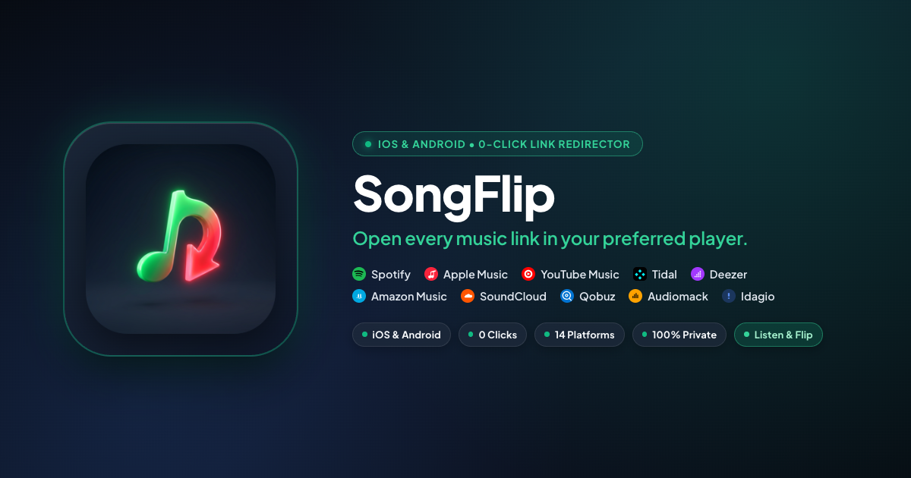

# SongFlip 🎵

<p align="center">
  
</p>

**SongFlip** is an automatic, zero-click music link redirector for Android & iOS (Spotify ⇄ Apple Music ⇄ YouTube Music ⇄ Tidal ⇄ Deezer ⇄ Amazon Music ⇄ SoundCloud ⇄ Bandcamp ⇄ Qobuz ⇄ Beatport ⇄ Audiomack ⇄ Idagio ⇄ Anghami).

Official Website: [songflip.link](https://songflip.link)

SongFlip runs completely in the background: set it up in 30 seconds, and whenever a friend shares a music link in WhatsApp, Telegram, Instagram, Shazam, or your browser, SongFlip instantly intercepts and converts it to open directly in your preferred music player without any intermediate UI or manual searching.

---

## ✨ Key Features

- **⚡ 0-Click Background Redirect**: Intercepts shared music links transparently (350ms zero-flicker threshold) and launches direct playback in your preferred player—with guided conflict diagnosis if another app hijacks links.
- **🎵 Listen & Flip & Offline Club Mode**: Identify music around you via Quick Settings tile, app shortcut, iPhone Action Button, or Siri Shortcuts (3 free scans/month; unlimited + offline signature queueing in PRO).
- **🔎 In-App Search, Disambiguation & Audiophile Matcher**: Search catalogs directly with compilation deduplication, pick alternative versions/remixes (`[PRO]`), or prioritize 24-bit Hi-Res, Lossless, and Dolby Atmos studio masters (`[PRO]`).
- **📑 Universal Playlist Converter & File Importer [PRO]**: Convert playlists (up to 200 tracks) with 1-click Zero-OAuth queue launch, `.M3U8`/`.CSV`/`.TXT` import & export, duplicate cleaning, and shareable web pages (`songflip.link/p/...`, [demo](https://songflip.link/p/76176a1354)).
- **🔗 Universal Smart Share Links & QR Codes [PRO]**: Generate multi-platform landing pages (`songflip.link/s/...`, [demo](https://songflip.link/s/rickroll)) with oEmbed/30s previews and in-app QR codes.
- **🎙️ Podcasts & Broad Multi-Service Support**: Cross-platform routing for tracks, albums, artists, and podcasts across **Spotify**, **YouTube / YouTube Music**, **Apple Music & Podcasts**, **Tidal**, **Deezer**, **Amazon Music**, **Pocket Casts**, **SoundCloud**, **Bandcamp**, **Qobuz**, **Beatport**, **Audiomack**, **Idagio**, **Anghami**, **Shazam**, and **Last.fm**.
- **📱 Multi-Player Discovery & Alternative Clients**: Detects installed players (including audiophile/FOSS clients like UAPP, BubbleUPnP, Musify, AntennaPod, Podcast Addict) with an optional "Ask every time" Quick Picker.
- **🛡️ Smart Safeguards & Emergency Scrapers**: Strips video clutter (`[Official Video]`, `4K`) while protecting original studio versions from unwanted remixes, plus client-side fallback scrapers when third-party APIs rate-limit.
- **📶 Offline Resilience & Native OS Integration**: Auto-retry queue for spotty connections, Clipboard Smart-Banner, iOS Share Extension & App Intents, Android Quick Settings tiles (Listen, Clipboard, Smart Pause), and Material You themed icons.
- **📜 Permanent History, Favorites & 34+ Languages**: Offline history with cover art, 1-tap favorites, WCAG AA accessible controls, 34+ in-app languages, and **100% zero-tracking privacy** (no accounts, no ads, no profiling).

---

## 🏗️ Architecture & Resolution Engine

> 📖 **Deep Dive**: For a comprehensive technical walkthrough of the deterministic resolution engine, tiered caching, playlist conversion pipeline, and edge cases, see **[ARCHITECTURE.md](ARCHITECTURE.md)**.

SongFlip is built as a modern **Kotlin Multiplatform (KMP)** project with a modular architecture:
- **`app/`**: Native Android app (Jetpack Compose, MVVM architecture with ViewModels & StateFlow, Material 3, Quick Settings Tile, Overlay & Notification handling).
- **`iosApp/`**: Native iOS app (SwiftUI, Share Extension, App Intents for 0-click Siri Shortcuts & Action Button).
- **`shared/`**: Shared KMP core engine (platform parsing, universal URL sanitizing, modular resolution engine (`SongLinkEngine`, `ShortLinkResolver`, `PodcastResolver`, `MetadataExtractor`, `L2CacheClient`, `ProEntitlementStore`), SQLDelight transactional SQLite cache, playlist conversion client, Ktor HTTP client, strict Structured Concurrency).
- **Cloud Backend** *(Private / Closed Source)*: Proprietary hosted cloud service (Firebase Cloud Functions by Daniel Notthoff) powering token verification, SSR web-share landing pages, playlist batch scrapers, and global L2 link caching. The client applications (Android, iOS & shared KMP core) are 100% autonomous and compile/run completely standalone.

### Resolution Pipeline
1. **Tier 1 (Local Device Memory & SQLDelight SQLite Cache)**: Instant sub-5ms lookup on device for previously converted songs.
2. **Tier 2 (L2 Server-Side Cloud Cache) [PRO]**: High-speed Firebase edge cache with 90-day TTL for zero-latency (<50ms) global conversions and web-share landing page generation (gracefully bypassed on network misses or local builds).
3. **Tier 3 (Direct 0-Redirect SongLink Engine)**: Normalizes incoming URLs into direct internal IDs for instant HTTP responses without redirect loops.
4. **Tier 4 (Direct Playback Extractor)**: Background video/track ID regex extraction for YouTube Music instant play.
5. **Tier 5 (Shazam & Catalog Discovery APIs)**: Shazam Discovery REST API (`amp.shazam.com`) for direct Apple Music IDs, iTunes Search & Lookup, Deezer Catalog API, Qobuz Public Catalog API, SoundCloud Web Scraper, and YouTube oEmbed.
6. **Tier 6 (Target Catalog Deep-Search Fallback)**: Intelligent 2-tier search routing (remaster/edit noise stripped) for obscure releases and regional variants.

---

## 👑 SongFlip PRO & Open Source Philosophy

The **SongFlip client app (Android & iOS) is 100% open source (GPLv3)** and operates completely autonomously on your device. Its core 0-click redirect functionality will **always remain completely free, ad-free, and tracker-free**.

For users who want the fastest possible performance, advanced playlist capabilities, or wish to support indie development, **SongFlip PRO** provides:

- **🎵 Unlimited Listen & Flip & Offline Club Mode**: Unlimited in-app music recognition plus offline acoustic fingerprinting for clubs, bars, and dead zones with automatic background matching once back online.
- **🎧 Audiophile Quality Matcher**: Automatic prioritization of Studio Masters, 24-bit Hi-Res, Lossless, and Spatial Audio releases over radio edits and compilations on Tidal, Qobuz, Apple Music, and Deezer.
- **📑 Universal Playlist Converter**: Convert full playlists (up to 200 songs) with 1-tap queue launch into YouTube Music & Spotify, multi-part chunking, duplicate cleaning, and .M3U8/.CSV export.
- **🌐 Playlist Web Sharing**: Create beautiful, shareable web links (`songflip.link/p/...`) with cover art and individual preview player buttons.
- **⚡ L2 Server-Side Cache**: Lightning-fast resolution (~30–50 ms) via our dedicated server cache with zero rate-limiting.
- **🔗 Universal Smart Share Links**: Generate `songflip.link/s/...` landing pages directly from the app or share sheet.
- **📱 QR-Code Sharing**: Generate high-resolution scannable QR codes in history for quick physical sharing.
- **👑 Supporter Status**: PRO badge & direct support for independent open-source development.

### 💳 In-App Purchases & Billing Architecture
Purchases are powered by **RevenueCat** with native store backends:
- **Android**: Google Play Billing Library 8+ via `com.revenuecat.purchases:purchases` (`ProManager.kt`)
- **iOS**: StoreKit 2 via RevenueCat iOS SDK v5 (`ProManager.swift`)
- **Options**: Non-consumable Lifetime purchase (`songflip_pro_lifetime`), Annual subscription (`songflip_pro_annual`), and Monthly subscription (`songflip_pro_monthly`).
- **Security & Offline Caching**: Asymmetric Ed25519 signature verification (`sct_v2_`), hardware-backed Keystore/Keychain storage, and monotonic `lastSeenServerTime` clock-rollback protection to safeguard offline entitlements across app restarts.


## 🛠️ Building & Development

### 1. Prerequisites
- **Java Development Kit (JDK)**: JDK 17+ (Eclipse Temurin or OpenJDK 17 recommended).
- **Android Development**: Android Studio Ladybug / Meerkat with Android SDK (API Level 26–36) and Command-line Tools.
- **iOS Development (macOS only)**: Xcode 16+ / Xcode 26 with Command Line Tools and iOS 17+ Simulator / Device SDKs.

> 💡 **Backend Notice**: The backend (Firebase Cloud Functions) is an optional service hosted by Daniel Notthoff. You do **not** need the backend code to build, test, or contribute to SongFlip. The client applications are 100% autonomous and a standard clone builds both Android and iOS targets out of the box.

### 2. Apple ShazamKit SDK for Android (Optional / Dual-Mode)
- **iOS**: Uses Apple's native system framework (`import ShazamKit`). No external binaries or credentials required.
- **Android**: SongFlip uses a dual-mode architecture to maintain 100% open-source buildability:
  - **Open-Source Mode (Default for Forks & Public Clones)**: If `app/libs/shazamkit-android-release.aar` is omitted, Gradle automatically compiles against an internal open-source stub (`src/stub/java`). The Android app builds and runs without any proprietary binaries out of the box.
  - **Production / Full Recognition Mode**: To enable acoustic music recognition on Android, download `shazamkit-android-release.aar` from the official [Apple Developer Portal (ShazamKit for Android)](https://developer.apple.com/shazamkit/) and place it in `app/libs/shazamkit-android-release.aar` (which is git-ignored). Gradle detects the file automatically and links the official Apple SDK.
  - **Official Release Builds**: Official production releases fetch the proprietary vendor SDK from the private backend repository via CI token (`SONGFLIP_API_READ_TOKEN`), keeping the public repository 100% clean of proprietary binary assets.

### 3. Environment Configuration
Copy `local.properties.example` to `local.properties` in the project root for local Android builds:
```properties
sdk.dir=/Users/<username>/Library/Android/sdk
# Optional keys (falls back to safe dev defaults if omitted):
# revenuecat.api.key=goog_...
# aptabase.app.key=A-EU-...
# aptabase.host=https://api.aptabase.com
# Optional proprietary cloud backend URLs (empty in open-source builds):
# songflip.backend.cache.url=
# songflip.backend.web.url=
```

For iOS development, copy `iosApp/SongFlip/Config.example.xcconfig` to `iosApp/SongFlip/Config.xcconfig` (git-ignored) and build the shared framework first:
```bash
./gradlew :shared:assembleSongFlipKitReleaseXCFramework
```

### 4. Build & Test Commands

#### Android Builds:
```bash
# Build Debug APK
./gradlew :app:assembleDebug

# Build Release APK / Bundle (unsigned or signed via SIGNING_KEYSTORE_PATH env)
./gradlew :app:assembleRelease
./gradlew :app:bundleRelease

# Optional: Generate Android Baseline Profile via Gradle Managed Device (:baselineprofile)
./gradlew :app:generateReleaseBaselineProfile
```

#### Shared KMP Core (iOS XCFramework):
```bash
# Generate the shared SongFlipKit.xcframework for iOS
./gradlew :shared:assembleSongFlipKitReleaseXCFramework
```

#### Run Automated Tests:
```bash
# Android & Shared KMP Test Suites (all debug & release unit tests)
./gradlew test
```

---

## 💖 Support & Sponsoring

If you love SongFlip and want to support its privacy-first, open-source development:

- **[Sponsor @thefraggle on GitHub](https://github.com/sponsors/thefraggle)**
- Leave a review on Google Play or the App Store!

---

## 📄 License & Trademarks

This project's source code is licensed under the **[GNU General Public License v3.0 (GPLv3)](LICENSE)**.

- **Freedom & Copyleft**: You are free to run, study, share, and modify the source code.
- **Copyleft Requirement**: Any distributed modifications or derivative works must also be licensed under the GNU GPLv3 with full source code made available.
- **Trademarks & Brand Assets**: Pursuant to GPLv3 Section 7(e), the **"SongFlip"** name, logos, app icons, package IDs (`de.goork.songflip`), and promotional store graphics (`docs/assets/store/`) are **not** licensed under the GPLv3 (*All Rights Reserved*). Redistributed forks must be rebranded with their own name and icons — see **[TRADEMARK.md](TRADEMARK.md)** for full details.

© 2026 Daniel Notthoff ([notthoff.org](https://notthoff.org))
